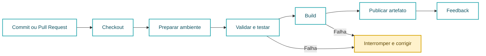
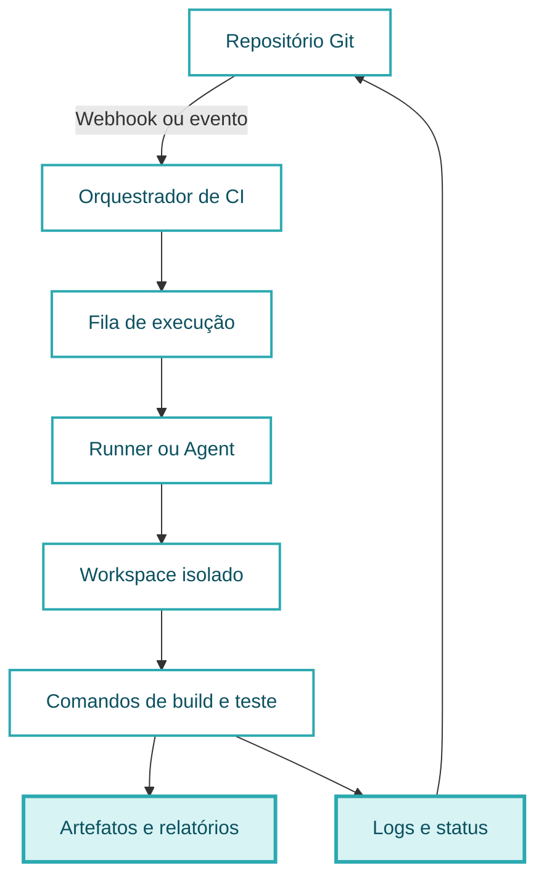
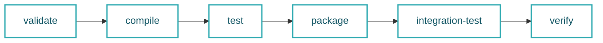
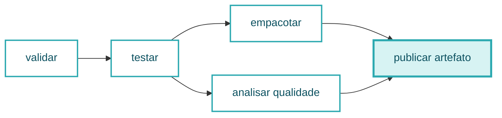
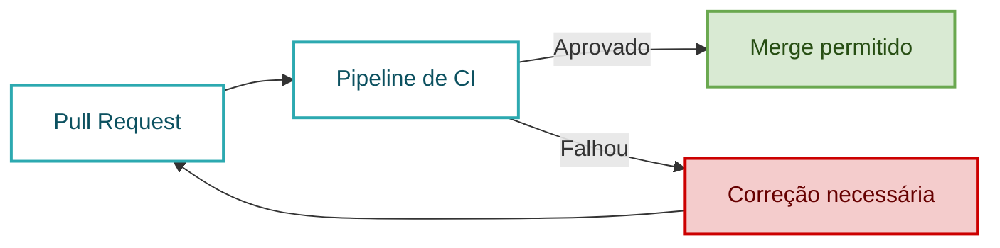
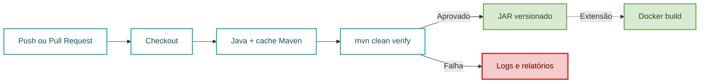

# Aula 10 — Integração Contínua: Ferramentas e Implementação

**Cloud Computing e DevOps Avançado**  
CST em Sistemas para Internet | 6º Período

---

## Slide 1: Abertura

### Aula 10 — Do Commit ao Artefato Verificado

- Segunda aula do segundo bimestre
- Integração Contínua na prática
- GitHub Actions, GitLab CI e Jenkins
- Implementação, diagnóstico e evidências
- Entrega do Trabalho 5
- Professor Ranghetti

---

## Slide 2: Objetivos da Aula

### Ao final desta aula você será capaz de

- Explicar o ciclo de uma execução de CI
- Relacionar gatilhos, executores, jobs, etapas e artefatos
- Implementar um pipeline mínimo como código
- Automatizar build e testes de um projeto Java com Maven
- Diferenciar cache de dependências e artefatos do build
- Investigar falhas por meio de logs e evidências
- Aplicar controles básicos de segurança e qualidade
- Entregar e demonstrar um pipeline reprodutível

---

## Slide 3: Agenda

- Retomada da Aula 09
- Integração contínua e feedback rápido
- Componentes de uma plataforma de CI
- Comparação entre ferramentas
- Pipeline como código
- GitHub Actions: implementação guiada
- GitLab CI e Jenkins: equivalência conceitual
- Qualidade, artefatos, cache e segurança
- Atividade prática
- Validação e entrega do Trabalho 5
- Glossário, referências e fechamento

---

## Slide 4: Posição no Cronograma Ajustado

| Aula | Conteúdo principal |
|---:|---|
| 09 | Cultura DevOps, automação e visão geral de pipelines |
| **10** | **Integração contínua: ferramentas e implementação** |
| 11 | Entrega contínua, estratégias de deploy e fundamentos de observabilidade |
| 12 | Observabilidade aplicada, alta disponibilidade, resiliência e recuperação de desastres |
| 13 | Segurança, DevSecOps, Zero Trust e FinOps |
| 14 | Revisão e consolidação do segundo bimestre |

- A Jornada Acadêmica ocorreu entre as Aulas 09 e 10
- Hoje encerramos o T5

---

## Slide 5: Retomada — O que Foi Modelado

- Um pipeline possui:
  - Evento de entrada
  - Etapas automatizadas
  - Critérios de aprovação ou falha
  - Artefatos e evidências
- CI busca integrar mudanças pequenas com frequência
- O feedback deve chegar antes que o erro avance
- O pipeline é parte do produto e deve ser versionado

### Pergunta de conexão

Como converter o desenho da Aula 09 em uma execução real e repetível?

---

## Slide 6: Retomada — Fluxo Essencial



---

## Slide 7: O que é Integração Contínua

- Prática de integrar alterações frequentemente
- Cada alteração é verificada automaticamente
- O repositório compartilhado representa a fonte de verdade
- O build deve ser:
  - Automatizado
  - Repetível
  - Rastreável
  - Rápido o suficiente para orientar a equipe
- Uma falha deve ficar visível e ser tratada rapidamente

---

## Slide 8: CI não é Apenas uma Ferramenta

### CI combina

- Hábitos de desenvolvimento
- Controle de versão
- Automação
- Testes
- Feedback
- Responsabilidade coletiva

### Instalar Jenkins ou criar um arquivo YAML não garante CI

- Commits enormes continuam difíceis de integrar
- Testes frágeis reduzem a confiança
- Falhas ignoradas transformam o pipeline em decoração

---

## Slide 9: Benefícios Esperados

- Detectar incompatibilidades cedo
- Reduzir trabalho manual repetitivo
- Padronizar o processo de verificação
- Tornar o estado do código visível
- Evitar o “funciona na minha máquina”
- Produzir artefatos com origem conhecida
- Criar base segura para entrega contínua

---

## Slide 10: Condições para uma CI Saudável

- Código versionado
- Build executável por comando
- Dependências declaradas
- Testes automatizados
- Ambiente previsível
- Pipeline versionado com o projeto
- Feedback claro
- Correção prioritária de falhas
- Segredos fora do código-fonte

---

## Slide 11: Anatomia de uma Plataforma de CI



---

## Slide 12: Vocabulário Estrutural

| Elemento | Função |
|---|---|
| Workflow ou pipeline | Define o processo automatizado completo |
| Trigger | Evento que inicia a execução |
| Runner ou agent | Máquina ou ambiente que executa os comandos |
| Job | Conjunto de etapas executado em um ambiente |
| Step | Ação ou comando dentro de um job |
| Stage | Agrupamento lógico, comum em GitLab CI e Jenkins |
| Workspace | Diretório temporário da execução |
| Artefato | Saída produzida e preservada pelo pipeline |

---

## Slide 13: Gatilhos Comuns

- `push` em uma branch
- Abertura ou atualização de pull request
- Criação de tag
- Execução manual
- Agenda programada
- Chamada por outro pipeline
- Evento externo via API

### Escolha do gatilho

- Deve refletir uma necessidade do fluxo
- Executar tudo em todo evento pode aumentar tempo e custo
- Deixar verificações importantes para depois aumenta risco

---

## Slide 14: Exemplo de Política de Gatilhos

| Evento | Verificações sugeridas |
|---|---|
| Pull request | Compilação, testes e qualidade |
| Push na branch principal | Verificação completa e geração de artefato |
| Tag de versão | Empacotamento e publicação controlada |
| Execução manual | Diagnóstico ou operação excepcional |
| Agenda | Verificações demoradas ou periódicas |

- A política deve ser simples, explícita e conhecida pela equipe

---

## Slide 15: Runner ou Agent

- Executa os jobs definidos no pipeline
- Pode ser:
  - Hospedado pela plataforma
  - Mantido pela organização
  - Efêmero ou persistente
- Precisa das ferramentas exigidas pelo build
- Deve receber apenas as permissões necessárias
- Um runner persistente exige atenção a resíduos entre execuções

---

## Slide 16: Ambiente Limpo e Reprodutível

### Pergunta-chave

O pipeline funciona porque está correto ou porque a máquina já estava preparada?

- Fixar a versão principal do ambiente
- Declarar dependências no projeto
- Evitar arquivos criados manualmente
- Não depender de configurações locais invisíveis
- Limpar saídas anteriores antes do build
- Documentar variáveis obrigatórias

---

## Slide 17: Ferramentas Previstas no Plano

| Ferramenta | Modelo comum | Definição como código |
|---|---|---|
| GitHub Actions | Integrado ao GitHub | `.github/workflows/*.yml` |
| GitLab CI/CD | Integrado ao GitLab | `.gitlab-ci.yml` |
| Jenkins | Servidor extensível e autogerenciado | `Jenkinsfile` |

- Todas podem implementar o mesmo fluxo lógico
- Sintaxe, operação, extensibilidade e modelo de execução variam
- A escolha depende do contexto, não apenas da popularidade

---

## Slide 18: Comparação Orientada à Decisão

| Aspecto | GitHub Actions | GitLab CI/CD | Jenkins |
|---|---|---|---|
| Integração inicial | Direta em repositórios GitHub | Direta na plataforma GitLab | Requer configuração do servidor e integrações |
| Executor | Runner | Runner | Agent ou node |
| Configuração | YAML | YAML | Pipeline declarativo ou scriptado |
| Operação | Serviço ou runners próprios | Serviço ou runners próprios | Administração sob responsabilidade da equipe |
| Extensão | Actions reutilizáveis | Templates e componentes | Amplo ecossistema de plugins |
| Cenário forte | Projetos hospedados no GitHub | Ciclo integrado no GitLab | Alto controle e ambientes personalizados |

---

## Slide 19: Pipeline como Código

- A definição fica no repositório
- Mudanças passam por revisão
- O histórico registra quem alterou e por quê
- Branches podem testar novas versões do pipeline
- O projeto carrega sua própria automação
- A configuração pode ser reproduzida em outro ambiente compatível

### Regra prática

Se uma etapa é necessária para validar o software, ela deve estar explícita no código do pipeline.

---

## Slide 20: Antes do YAML — O Comando Local

### Projeto Java com Maven

```bash
mvn -B clean verify
```

- `-B`: modo não interativo, adequado à automação
- `clean`: remove saídas de builds anteriores
- `verify`: percorre as fases anteriores e executa verificações configuradas
- O mesmo comando deve funcionar localmente e no CI

### Primeiro diagnóstico

Se o comando não funciona em um ambiente limpo, o YAML não resolverá o problema.

---

## Slide 21: Ciclo Maven no Pipeline



- Ao solicitar `verify`, o Maven executa as fases anteriores aplicáveis
- Plugins do projeto podem adicionar verificações ao ciclo
- A saída típica de um projeto JAR fica em `target/`

---

## Slide 22: Estrutura do Exemplo

```text
projeto-java/
├── .github/
│   └── workflows/
│       └── ci.yml
├── src/
│   ├── main/java/
│   └── test/java/
├── pom.xml
└── README.md
```

- `pom.xml`: dependências, plugins e configuração do build
- `src/test`: testes automatizados
- `ci.yml`: comportamento da automação
- `README.md`: instruções para executar e validar

---

## Slide 23: GitHub Actions — Estrutura Básica

```yaml
name: CI

on:
  push:
  pull_request:

jobs:
  build:
    runs-on: ubuntu-latest
    steps:
      - name: Obter o código
        uses: actions/checkout@v4
```

- `name`: nome visível do workflow
- `on`: eventos de início
- `jobs`: unidades de execução
- `runs-on`: ambiente do runner
- `steps`: sequência dentro do job

---

## Slide 24: Eventos com Escopo

```yaml
on:
  push:
    branches: [main]
  pull_request:
    branches: [main]
  workflow_dispatch:
```

- `push`: executa ao atualizar a branch principal
- `pull_request`: verifica mudanças antes da integração
- `workflow_dispatch`: permite execução manual
- Restringir branches evita execuções sem finalidade
- A política do projeto deve justificar as restrições

---

## Slide 25: Permissões Explícitas

```yaml
permissions:
  contents: read
```

- O workflow deste exemplo precisa apenas ler o repositório
- Permissões devem ser concedidas pelo menor privilégio
- Um job que publica pacotes exigirá permissão adicional
- Não ampliar permissões “para garantir que funcione”
- Segurança começa na configuração mínima

---

## Slide 26: Preparar o Java e o Maven

```yaml
- name: Configurar Java
  uses: actions/setup-java@v4
  with:
    distribution: temurin
    java-version: "17"
    cache: maven
```

- A versão deve ser compatível com o projeto
- Neste exemplo didático usamos Java 17
- `cache: maven` reutiliza dependências para acelerar execuções
- O cache não substitui o artefato produzido pelo build

---

## Slide 27: Executar a Verificação

```yaml
- name: Compilar, testar e verificar
  run: mvn -B clean verify
```

### Resultado esperado

- Dependências resolvidas
- Código compilado
- Testes executados
- Pacote gerado
- Verificações configuradas aplicadas
- Código de saída diferente de zero interrompe o job

---

## Slide 28: Publicar o Artefato

```yaml
- name: Armazenar pacote gerado
  if: success()
  uses: actions/upload-artifact@v4
  with:
    name: pacote-${{ github.sha }}
    path: target/*.jar
    if-no-files-found: error
```

- Preserva a saída após o fim do job
- O SHA relaciona o pacote ao commit
- Ausência do arquivo esperado deve causar erro
- O padrão deve ser ajustado ao empacotamento real do projeto

---

## Slide 29: Workflow Completo — Parte 1

```yaml
name: CI Java

on:
  push:
    branches: [main]
  pull_request:
    branches: [main]
  workflow_dispatch:

permissions:
  contents: read

jobs:
  build-test:
    runs-on: ubuntu-latest
    timeout-minutes: 10
```

---

## Slide 30: Workflow Completo — Parte 2

```yaml
    steps:
      - name: Obter o código
        uses: actions/checkout@v4

      - name: Configurar Java
        uses: actions/setup-java@v4
        with:
          distribution: temurin
          java-version: "17"
          cache: maven

      - name: Compilar, testar e verificar
        run: mvn -B clean verify
```

---

## Slide 31: Workflow Completo — Parte 3

```yaml
      - name: Armazenar relatórios de teste
        if: always()
        uses: actions/upload-artifact@v4
        with:
          name: relatorios-${{ github.sha }}
          path: target/surefire-reports/
          if-no-files-found: warn

      - name: Armazenar pacote gerado
        if: success()
        uses: actions/upload-artifact@v4
        with:
          name: pacote-${{ github.sha }}
          path: target/*.jar
          if-no-files-found: error
```

---

## Slide 32: Por que Há Duas Condições?

### `if: always()` nos relatórios

- Evidências de teste são úteis também quando há falha
- A etapa tenta preservar informações para diagnóstico

### `if: success()` no pacote

- O artefato de entrega só deve existir após verificações aprovadas
- Evita tratar uma saída incompleta como versão válida

---

## Slide 33: Cache não é Artefato

| Cache | Artefato |
|---|---|
| Acelera execuções futuras | Preserva uma saída do job |
| Guarda dependências ou dados regeneráveis | Guarda pacote, relatório ou evidência |
| Pode não estar disponível | Deve representar uma saída identificada |
| Não comprova uma entrega | Pode ser baixado, analisado ou promovido |

### Exemplos

- Cache: dependências Maven em `.m2`
- Artefato: arquivo JAR em `target/`

---

## Slide 34: Rastreabilidade do Artefato

- Associar artefato a:
  - Repositório
  - Commit
  - Branch ou tag
  - Execução do pipeline
  - Resultado dos testes
- Evitar nomes genéricos como `final.jar`
- Exemplos de identificação:
  - SHA do commit
  - Versão semântica
  - Número da execução

---

## Slide 35: Jobs Únicos ou Separados?

### Um único job

- Mais simples para começar
- Compartilha o mesmo workspace
- Adequado ao pipeline mínimo

### Jobs separados

- Isolam responsabilidades
- Podem executar em paralelo
- Exigem passagem explícita de artefatos
- Facilitam controles diferentes por etapa

### Decisão didática

Começar simples e separar quando existir uma razão mensurável.

---

## Slide 36: Exemplo com Jobs Dependentes



- Uma dependência impede a execução prematura
- Paralelismo reduz tempo apenas quando os jobs são independentes

---

## Slide 37: Quality Gate

- Regra objetiva que decide se a mudança pode avançar
- Exemplos:
  - Compilação sem erro
  - Todos os testes aprovados
  - Lint sem violações bloqueantes
  - Cobertura mínima, quando definida
  - Ausência de vulnerabilidade acima do limite aceito
- O critério deve ser conhecido antes da execução

---

## Slide 38: Status Check e Proteção da Branch



- A proteção transforma a verificação em política aplicada
- Exigir revisão e status aprovado reduz integrações defeituosas

---

## Slide 39: Lint, Teste e Build

| Verificação | Pergunta respondida |
|---|---|
| Lint ou análise estática | O código respeita regras verificáveis? |
| Teste | O comportamento esperado continua válido? |
| Build | O projeto pode ser compilado e empacotado? |

- A ferramenta de lint deve estar declarada no projeto
- Não inventar uma etapa sem configurar a ferramenta correspondente
- Em Maven, plugins podem integrar qualidade ao ciclo `verify`

---

## Slide 40: Falhar Cedo

- Executar primeiro as verificações:
  - Rápidas
  - Baratas
  - Com alta probabilidade de detectar problema
- Evitar produzir artefato quando testes já falharam
- Reservar tarefas demoradas para depois das validações básicas

### Exemplo de ordem

1. Validação de estrutura
2. Compilação
3. Testes
4. Qualidade e segurança
5. Empacotamento e publicação

---

## Slide 41: Estratégia de Diagnóstico

1. Localizar o primeiro job que falhou
2. Identificar a primeira etapa com erro
3. Ler a mensagem original, não apenas o resumo final
4. Verificar o código de saída
5. Reproduzir o comando localmente
6. Comparar ambiente, versão e variáveis
7. Corrigir a causa
8. Reexecutar e registrar a evidência

---

## Slide 42: Falhas Frequentes

| Sintoma | Causa provável | Investigação inicial |
|---|---|---|
| Comando não encontrado | Ferramenta ausente ou etapa de setup incorreta | Conferir preparação do ambiente |
| Dependência não baixa | Rede, repositório ou versão inválida | Ler log do gerenciador de dependências |
| Teste passa localmente | Estado residual ou diferença de ambiente | Reproduzir em ambiente limpo |
| Artefato não localizado | Caminho ou empacotamento incorreto | Inspecionar diretório de saída |
| YAML não inicia | Sintaxe ou gatilho incorreto | Validar arquivo e evento esperado |
| Acesso negado | Permissão ou segredo ausente | Conferir política e escopo |

---

## Slide 43: Experimento — Falha Controlada

- Criar uma alteração que faça um teste falhar
- Enviar a alteração para a branch de exercício
- Observar:
  - Status da execução
  - Etapa que parou
  - Mensagem do teste
  - Ausência do pacote aprovado
- Corrigir o problema
- Executar novamente
- Preservar evidências das duas situações

---

## Slide 44: Evidência Boa e Evidência Fraca

### Evidência boa

- Mostra repositório, commit e execução
- Exibe etapas e resultado
- Permite localizar logs
- Identifica o artefato
- Inclui falha e correção

### Evidência fraca

- Print recortado sem contexto
- Apenas tela verde
- Arquivo local sem origem
- Log copiado sem identificação da execução

---

## Slide 45: Segredos no Pipeline

- Senhas, tokens e chaves não pertencem ao repositório
- Usar o mecanismo de secrets ou credentials da plataforma
- Evitar imprimir valores sensíveis nos logs
- Restringir escopo e duração das credenciais
- Separar credenciais por ambiente
- Revogar imediatamente um segredo exposto

---

## Slide 46: Dependências e Ações de Terceiros

- Cada componente externo amplia a cadeia de suprimentos
- Preferir fontes confiáveis
- Fixar versões conforme a política do projeto
- Revisar permissões solicitadas
- Remover componentes não utilizados
- Atualizar conscientemente, com teste e revisão

### Pergunta

Que código externo recebe acesso ao repositório durante o build?

---

## Slide 47: GitLab CI — Mesmo Fluxo

```yaml
stages:
  - test
  - build

testar:
  stage: test
  image: maven:3-eclipse-temurin-17
  script:
    - mvn -B test

empacotar:
  stage: build
  image: maven:3-eclipse-temurin-17
  script:
    - mvn -B package
  artifacts:
    paths:
      - target/*.jar
```

---

## Slide 48: Leitura do Exemplo GitLab CI

- Arquivo: `.gitlab-ci.yml`
- `stages`: ordem lógica
- `image`: ambiente de execução do job
- `script`: comandos executados
- `artifacts`: arquivos preservados
- O job de build só avança após o estágio anterior

### Atenção

O exemplo é mínimo; cache, regras, relatórios e permissões devem ser adicionados conforme o projeto.

---

## Slide 49: Jenkins — Mesmo Fluxo

```groovy
pipeline {
    agent any
    stages {
        stage('Build e testes') {
            steps {
                sh 'mvn -B clean verify'
            }
        }
    }
    post {
        success {
            archiveArtifacts artifacts: 'target/*.jar', fingerprint: true
        }
    }
}
```

---

## Slide 50: Leitura do Jenkinsfile

- Arquivo normalmente chamado `Jenkinsfile`
- `pipeline`: processo completo
- `agent`: local de execução
- `stages`: grupos de trabalho
- `steps`: comandos
- `post`: ações condicionadas ao resultado
- `archiveArtifacts`: preserva saídas no Jenkins
- `fingerprint`: auxilia a rastrear o uso do artefato

---

## Slide 51: Tradução entre Ferramentas

| Conceito | GitHub Actions | GitLab CI/CD | Jenkins |
|---|---|---|---|
| Definição | Workflow YAML | Pipeline YAML | Jenkinsfile |
| Executor | Runner | Runner | Agent ou node |
| Unidade de execução | Job | Job | Stage e steps |
| Comando | `run` | `script` | `sh` ou `bat` |
| Artefato | Upload artifact | `artifacts` | Archive artifacts |
| Credencial | Secret | CI/CD variable | Credential |

- O conceito é transferível; a sintaxe muda

---

## Slide 52: Caso Aplicação Biblioteca

- Projeto Java versionado
- Build orientado pelo `pom.xml`
- Pipeline deve executar em ambiente limpo
- Testes existentes devem ser executados
- Pacote deve ser preservado como artefato
- Execução deve ser associada ao commit

### Extensão opcional

Construir a imagem Docker somente depois da aprovação do build e dos testes.

---

## Slide 53: Pipeline do Caso Biblioteca



---

## Slide 54: Atividade Prática — Organização

- Manter as equipes do Trabalho 5
- Tempo sugerido: 70–90 minutos
- Escolher uma ferramenta autorizada
- Projeto:
  - Aplicação Biblioteca
  - Ou projeto equivalente autorizado
- Meta:
  - Implementar, executar, testar uma falha, corrigir e entregar

---

## Slide 55: Atividade — Etapa 1: Diagnóstico Local

1. Clonar ou atualizar o repositório
2. Identificar linguagem e ferramenta de build
3. Conferir arquivos obrigatórios
4. Executar o build em ambiente local
5. Localizar testes e saída gerada
6. Registrar o comando reprodutível

### Para Maven

```bash
mvn -B clean verify
```

---

## Slide 56: Atividade — Etapa 2: Implementação

1. Criar o arquivo de pipeline
2. Definir gatilho
3. Configurar ambiente
4. Obter o código
5. Executar testes e build
6. Publicar relatórios disponíveis
7. Publicar o artefato
8. Enviar a alteração ao repositório

---

## Slide 57: Atividade — Etapa 3: Validação

- Confirmar execução bem-sucedida
- Baixar ou visualizar o artefato
- Relacionar execução e commit
- Introduzir uma falha controlada
- Confirmar que o pipeline bloqueia o fluxo
- Corrigir a falha
- Confirmar nova execução aprovada
- Registrar as evidências

---

## Slide 58: Atividade — Etapa 4: Revisão Cruzada

- Trocar o repositório com outra equipe
- Verificar sem explicação prévia:
  - O README informa como executar?
  - O gatilho é compreensível?
  - As etapas possuem nomes claros?
  - Testes realmente são executados?
  - O artefato pode ser localizado?
  - Uma falha interrompe o fluxo?
  - Há segredo exposto?
- Registrar uma melhoria objetiva

---

## Slide 59: Desafio de Diagnóstico

### Situação

O pipeline fica verde, mas nenhum teste aparece no log e nenhum relatório é produzido.

### Investigue

- Existem testes no caminho esperado?
- O framework de teste está configurado?
- O Maven informou “No tests to run”?
- O comando usado alcança a fase de teste?
- A ausência de testes deveria ser aceita pelo projeto?

### Aprendizado

Status verde não substitui a leitura das evidências.

---

## Slide 60: Trabalho 5 — Entrega Hoje

- Tema:
  - Pipeline CI mínimo e reprodutível
- Valor:
  - Até 1,0 ponto
- Entrega:
  - Ao final da Aula 10
- Ferramenta:
  - Jenkins, GitLab CI, GitHub Actions ou outra autorizada
- A entrega representa a implementação do modelo iniciado na Aula 09

---

## Slide 61: T5 — Entregáveis

- Repositório acessível ao professor
- Arquivo de definição do pipeline
- Instruções de reprodução no README
- Pipeline com:
  - Gatilho
  - Build
  - Testes disponíveis
  - Tratamento de falha
  - Artefato identificado
- Evidência de sucesso
- Evidência de falha detectada e posterior correção
- Explicação sobre proteção de segredos

---

## Slide 62: T5 — Critérios de Avaliação

| Critério | Valor |
|---|---:|
| Pipeline executável e reprodutível |  |
| Build, testes e tratamento de falhas |  |
| Artefato e rastreabilidade |  |
| Evidências e instruções |  |
| Segurança básica e organização |  |
| **Total** | **1,00** |

---

## Slide 63: T5 — Checklist Final

- O professor consegue acessar o repositório?
- O pipeline é iniciado pelo evento documentado?
- O build funciona em ambiente limpo?
- Os testes disponíveis são executados?
- Uma falha torna a execução inválida?
- O artefato pode ser associado ao commit?
- Logs e relatórios ajudam no diagnóstico?
- O README permite reproduzir o processo?
- Não existem credenciais no código ou nos logs?

---

## Slide 64: T5 — Demonstração Rápida

- Tempo sugerido: até 3 minutos por equipe
- Apresentar:
  1. Repositório e arquivo do pipeline
  2. Evento que inicia a execução
  3. Build e testes
  4. Evidência de uma falha detectada
  5. Execução corrigida
  6. Artefato gerado
- Todos os integrantes devem compreender o fluxo

---

## Slide 65: Erros que Comprometem a Entrega

- Pipeline apenas desenhado, sem execução
- Build executado manualmente fora do pipeline
- Testes ignorados para obter status verde
- Artefato sem relação com a execução
- Evidência sem identificação do commit
- Configuração presente somente na interface
- Segredo inserido no repositório
- README insuficiente para reprodução

---

## Slide 66: Glossário — Integração Contínua

| Termo | Significado |
|---|---|
| **CI** | Integração Contínua; prática de integrar e verificar mudanças frequentemente |
| **SCM** | Gerenciamento de código-fonte, como Git |
| **Pipeline as Code** | Definição versionada do processo automatizado |
| **Trigger** | Evento que inicia uma execução |
| **Workflow** | Processo automatizado composto por um ou mais jobs |
| **Job** | Unidade de execução formada por etapas |
| **Step** | Ação ou comando individual dentro de um job |

---

## Slide 67: Glossário — Execução e Qualidade

| Termo | Significado |
|---|---|
| **Runner** | Executor de jobs no GitHub Actions ou GitLab CI/CD |
| **Agent** | Ambiente que executa etapas de um pipeline Jenkins |
| **Workspace** | Diretório usado durante a execução |
| **Lint** | Análise automatizada de regras de código e estilo |
| **Quality gate** | Conjunto de condições para permitir avanço no fluxo |
| **Status check** | Resultado de uma verificação associado a commit ou pull request |
| **Fail fast** | Estratégia de interromper cedo após uma falha relevante |

---

## Slide 68: Glossário — Saídas e Segurança

| Termo | Significado |
|---|---|
| **Artefato** | Arquivo produzido e preservado por uma execução |
| **Cache** | Dados reutilizados para reduzir o tempo de execuções futuras |
| **SHA** | Identificador calculado usado pelo Git para representar objetos e commits |
| **Secret** | Valor sensível armazenado e fornecido de forma controlada |
| **Menor privilégio** | Concessão apenas das permissões necessárias |
| **Cadeia de suprimentos de software** | Componentes, ferramentas e processos envolvidos na produção do software |
| **Reprodutibilidade** | Capacidade de repetir o processo com resultado consistente |

---

## Slide 69: Referências Bibliográficas

### Bibliografia do plano de ensino

- KOLBE JÚNIOR, Armando. *Computação em Nuvem*. 1. ed. São Paulo: Contentus, 2020.
- SOUSA NETO, Manoel Veras de. *Computação em Nuvem*. 1. ed. Rio de Janeiro: Brasport, 2015.
- MUNIZ, Antonio; IRIGOYEN, Analia. *Jornada DevOps*. 2. ed. Rio de Janeiro: Brasport, 2020.
- FREEMAN, Emily. *DevOps para leigos*. São Paulo: Alta Books, 2021.
- SATO, Danilo. *DevOps na prática: entrega de software confiável e automatizada*. São Paulo: Casa do Código, 2013.

---

## Slide 70: Referências Técnicas Oficiais

- GitHub Docs. *Understanding GitHub Actions*. Disponível em: <https://docs.github.com/actions/about-github-actions/understanding-github-actions>.
- GitHub Docs. *Workflow syntax for GitHub Actions*. Disponível em: <https://docs.github.com/actions/writing-workflows/workflow-syntax-for-github-actions>.
- GitHub Docs. *Workflow artifacts*. Disponível em: <https://docs.github.com/actions/concepts/workflows-and-actions/workflow-artifacts>.
- GitLab Docs. *CI/CD YAML syntax reference*. Disponível em: <https://docs.gitlab.com/ci/yaml/>.
- Jenkins. *Pipeline*. Disponível em: <https://www.jenkins.io/doc/book/pipeline/>.
- Apache Maven. *Introduction to the Build Lifecycle*. Disponível em: <https://maven.apache.org/guides/introduction/introduction-to-the-lifecycle.html>.

Acessos em: 14 out. 2026.

---

## Slide 71: Síntese da Aula

- CI combina prática de equipe e automação
- O pipeline deve estar versionado
- Gatilhos conectam eventos a verificações
- Runners ou agents executam jobs em ambientes controlados
- Build e testes devem ser reproduzíveis
- Cache acelera; artefato registra uma saída
- Logs e falhas são fontes de aprendizado
- Segurança e rastreabilidade começam no pipeline mínimo

---

## Slide 72: Próxima Aula

### Aula 11 — Entrega Contínua e Estratégias de Deploy

- Diferença entre integrar, entregar e implantar
- Versionamento de releases
- Estratégias blue/green e canary
- Critérios de promoção
- Rollback
- Fundamentos de observabilidade para validar o deploy
- Lançamento do Trabalho 6

---

## Slide 73: Perguntas e Encerramento

### Perguntas para reflexão

- Qual falha seu pipeline consegue descobrir hoje?
- Que falha ainda escaparia?
- Outra pessoa consegue reproduzir o build?
- O artefato pode ser relacionado ao código que o originou?
- O feedback chega a tempo de orientar a equipe?

### Entrega

- Finalizar, validar, demonstrar e entregar o Trabalho 5
