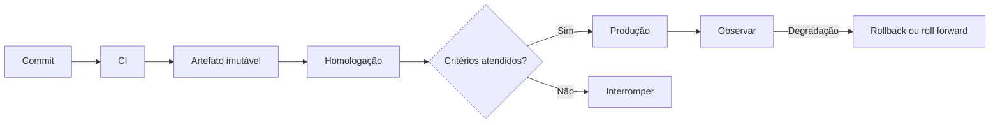
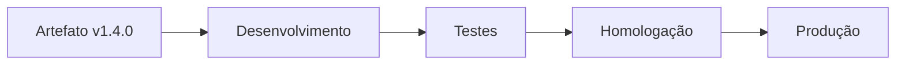
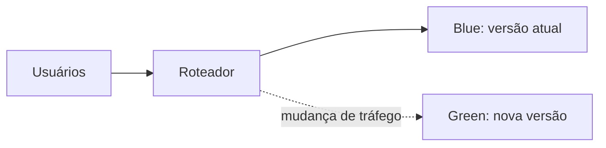
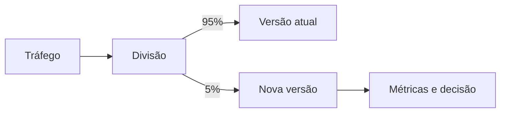
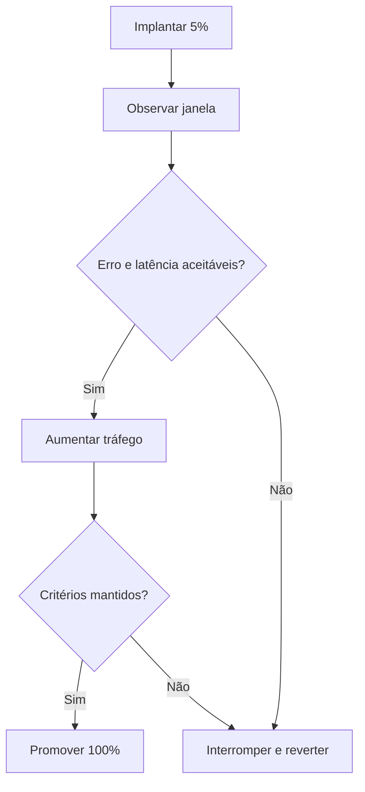

# Aula 11 — Entrega Contínua, Estratégias de Deploy e Observabilidade

**Cloud Computing e DevOps Avançado**  
CST em Sistemas para Internet | 6º Período

---

## Slide 1: Abertura

### Aula 11 — Do Artefato Verificado à Entrega Segura

- Entrega contínua
- Estratégias de deploy
- Versionamento, promoção e rollback
- Fundamentos de observabilidade
- Lançamento do Trabalho 6
- Professor Ranghetti

---

## Slide 2: Objetivos da Aula

- Diferenciar integração, entrega e implantação contínuas
- Desenhar um pipeline de CD com controles
- Comparar rolling, blue/green e canary
- Definir critérios de promoção e rollback
- Relacionar versão, artefato, configuração e ambiente
- Explicar como sinais observáveis validam um deploy
- Elaborar uma estratégia de entrega para um serviço

---

## Slide 3: Agenda

- Retomada da CI
- Entrega contínua e implantação contínua
- Pipeline de CD
- Versionamento e promoção
- Estratégias de deploy
- Rollback e roll forward
- Configuração e banco de dados
- Observabilidade do deploy
- Atividade prática
- Lançamento do T6
- Glossário e referências

---

## Slide 4: Cronograma do Segundo Bimestre

| Aula | Conteúdo principal |
|---:|---|
| 09 | Cultura DevOps e pipelines |
| 10 | Integração contínua e implementação |
| **11** | **CD, estratégias de deploy e observabilidade inicial** |
| 12 | Observabilidade aplicada, alta disponibilidade, resiliência e DR |
| 13 | Segurança, DevSecOps, Zero Trust e FinOps |
| 14 | Revisão e consolidação |

---

## Slide 5: Conexão com a Aula 10

- A CI entregou um artefato:
  - Testado
  - Identificado
  - Rastreável
- Agora precisamos responder:
  - Como promover o mesmo artefato?
  - Como reduzir risco da implantação?
  - Como detectar impacto?
  - Como recuperar o serviço?

---

## Slide 6: CI, Entrega e Implantação

| Prática | Resultado |
|---|---|
| Integração contínua | Mudança integrada e verificada |
| Entrega contínua | Mudança pronta para produção |
| Implantação contínua | Mudança aprovada implantada automaticamente |

- A entrega contínua pode manter aprovação humana antes de produção
- A implantação contínua automatiza também essa passagem

---

## Slide 7: Fluxo de Entrega

---

## Slide 8: Princípios de uma Entrega Confiável

- Automatizar tarefas repetíveis
- Promover o mesmo artefato
- Separar código e configuração
- Validar antes e depois do deploy
- Aplicar menor privilégio
- Registrar aprovações e mudanças
- Tornar reversão possível
- Observar impacto no usuário

---

## Slide 9: Artefato Imutável

- É produzido uma vez
- Recebe identificação única
- Não é recompilado entre ambientes
- Configuração externa adapta o comportamento
- Permite relacionar:
  - Commit
  - Build
  - Testes
  - Deploy
  - Ambiente

---

## Slide 10: Promoção entre Ambientes

- Promover significa avançar o mesmo artefato
- Cada ambiente aplica sua configuração autorizada
- Recompilar cria uma saída diferente e quebra a rastreabilidade

---

## Slide 11: Versionamento de Releases

- Versão deve permitir identificar uma entrega
- Fontes possíveis:
  - Tag Git
  - Versão semântica
  - SHA do commit
  - Número do pipeline
- Exemplo semântico:
  - `2.3.1` = major.minor.patch
- A política precisa ser consistente

---

## Slide 12: Release não é Deploy

- Release: disponibilizar funcionalidade para uso
- Deploy: instalar uma versão em um ambiente
- Podem ocorrer juntos ou separados
- Feature flags permitem:
  - Implantar código desativado
  - Liberar gradualmente
  - Separar risco técnico de decisão de negócio

---

## Slide 13: Estratégia Recreate

- Versão anterior é encerrada
- Nova versão é iniciada
- Simples e econômica
- Pode causar indisponibilidade
- Adequada quando:
  - Interrupção é aceitável
  - Há restrição de recursos
  - Aplicação não suporta versões simultâneas

---

## Slide 14: Rolling Update

- Instâncias são substituídas gradualmente
- Parte da capacidade permanece disponível
- Requer compatibilidade temporária entre versões
- É comum em orquestradores
- Riscos:
  - Estado misto
  - Falha lenta de detectar
  - Capacidade insuficiente durante a troca

---

## Slide 15: Blue/Green

- Dois ambientes equivalentes
- Nova versão é validada sem tráfego principal
- Troca rápida de rota
- Rollback pode redirecionar ao ambiente anterior
- Exige capacidade adicional

---

## Slide 16: Canary

- Exposição gradual
- Percentual cresce conforme critérios
- Limita o impacto inicial
- Exige roteamento e observabilidade confiáveis

---

## Slide 17: Comparação das Estratégias

| Estratégia | Custo | Risco inicial | Reversão | Complexidade |
|---|---:|---:|---:|---:|
| Recreate | Baixo | Alto | Mais lenta | Baixa |
| Rolling | Médio | Médio | Gradual | Média |
| Blue/green | Alto | Baixo | Rápida | Média |
| Canary | Variável | Baixo | Por tráfego | Alta |

- A melhor opção depende do sistema e dos objetivos

---

## Slide 18: Critérios de Escolha

- Tolerância à indisponibilidade
- Criticidade do serviço
- Custo de ambientes paralelos
- Compatibilidade entre versões
- Capacidade de segmentar tráfego
- Velocidade de detecção
- Complexidade operacional
- Estratégia de dados

---

## Slide 19: Readiness e Health Checks

- Liveness: processo precisa ser reiniciado?
- Readiness: instância pode receber tráfego?
- Startup: aplicação terminou de iniciar?
- Checks devem representar condições úteis
- Um endpoint que sempre retorna `200` produz falsa segurança

---

## Slide 20: Smoke Tests

- Verificações rápidas após o deploy
- Cobrem caminhos essenciais
- Exemplos:
  - Serviço responde
  - Autenticação funciona
  - Operação crítica conclui
  - Dependência essencial está acessível
- Não substituem testes completos

---

## Slide 21: Quality Gate de Deploy

| Gate | Pergunta |
|---|---|
| Artefato | A origem e a integridade são conhecidas? |
| Testes | Verificações obrigatórias passaram? |
| Segurança | Controles mínimos foram atendidos? |
| Aprovação | A mudança está autorizada? |
| Saúde | O ambiente está apto? |
| Observação | Métricas permanecem dentro dos limites? |

---

## Slide 22: Rollback

- Retorno a uma versão conhecida
- Precisa ser planejado antes do deploy
- Deve considerar:
  - Aplicação
  - Configuração
  - Dados
  - Mensagens
  - Integrações
- Reverter binário é fácil; reverter estado pode não ser

---

## Slide 23: Roll Forward

- Corrigir avançando para uma nova versão
- Pode ser preferível quando:
  - Migração de dados não é reversível
  - Falha é pequena e bem compreendida
  - Reversão causaria impacto maior
- Exige capacidade de produzir e validar correção rapidamente

---

## Slide 24: Banco de Dados e Compatibilidade

- Aplicar mudanças compatíveis em etapas
- Padrão expandir e contrair:
  1. Adicionar estrutura nova
  2. Suportar formatos antigo e novo
  3. Migrar dados
  4. Remover estrutura antiga depois
- Evitar alteração destrutiva no mesmo instante do deploy

---

## Slide 25: Configuração e Segredos

- Configuração varia por ambiente
- Segredos devem vir de mecanismo protegido
- Não inserir credenciais na imagem
- Validar configurações antes de promover
- Versionar estrutura e documentação, não valores secretos
- Registrar quem alterou e quando

---

## Slide 26: Aprovação Manual

- Pode ser necessária por risco ou compliance
- Deve possuir:
  - Responsável
  - Evidências
  - Critérios
  - Prazo
  - Registro
- Aprovação sem informação é apenas espera

---

## Slide 27: O que é Observabilidade?

- Capacidade de compreender o estado interno pelas saídas do sistema
- Permite investigar perguntas não previstas
- Usa sinais como:
  - Métricas
  - Logs
  - Traces
  - Eventos
- Monitoramento acompanha condições conhecidas; observabilidade amplia investigação

---

## Slide 28: Três Sinais Principais

| Sinal | Pergunta |
|---|---|
| Métrica | Quanto e com que frequência? |
| Log | O que aconteceu neste ponto? |
| Trace | Por onde a requisição passou? |

- O valor aumenta quando os sinais podem ser correlacionados

---

## Slide 29: Métricas para Validar um Deploy

- Taxa de erro
- Latência
- Volume de requisições
- Saturação de recursos
- Reinicializações
- Fila ou backlog
- Conversão ou conclusão de operação crítica
- Comparação antes e depois da mudança

---

## Slide 30: Critério de Promoção Canary

---

## Slide 31: Deploy não Termina no “Sucesso”

- Pipeline concluído indica execução técnica
- Não garante experiência correta do usuário
- É necessário observar uma janela após deploy
- Critérios precisam incluir resultado operacional e de negócio
- Mudança sem acompanhamento aumenta tempo de detecção

---

## Slide 32: Atividade — Cenário

- Serviço web de biblioteca
- Uso cresce no início de cada semestre
- Indisponibilidade máxima tolerada: 5 minutos
- Banco de dados compartilhado
- Nova versão altera empréstimos
- Equipe possui métricas de erro e latência
- Objetivo: criar plano de deploy e rollback

---

## Slide 33: Atividade — Plano de Deploy

- Definir:
  1. Artefato e versão
  2. Ambientes
  3. Estratégia escolhida
  4. Pré-condições
  5. Passos de implantação
  6. Smoke tests
  7. Critérios de promoção
  8. Responsáveis

---

## Slide 34: Atividade — Rollback

- Definir gatilhos objetivos
- Explicar como restaurar aplicação
- Tratar configuração
- Tratar mudança no banco
- Estimar tempo de recuperação
- Informar stakeholders
- Registrar evidências da decisão

---

## Slide 35: Atividade — Apresentação

- Até 5 minutos por equipe
- Mostrar:
  - Estratégia e justificativa
  - Fluxo do pipeline
  - Gates
  - Métricas observadas
  - Gatilho e plano de rollback
- A turma identifica um risco não tratado

---

## Slide 36: Trabalho 6 — Lançamento

- Tema:
  - Estratégia de CD, deploy e rollback
- Valor:
  - Até 1,0 ponto
- Entrega:
  - Aula 12
- Equipes:
  - Conforme organização definida pelo professor

---

## Slide 37: T6 — Entregáveis

- Contexto e requisitos do serviço
- Diagrama do fluxo de entrega
- Estratégia de deploy escolhida
- Política de versionamento e promoção
- Critérios de sucesso
- Smoke tests
- Plano de rollback ou roll forward
- Riscos e mitigações
- Evidências que orientam a decisão

---

## Slide 38: T6 — Critérios

| Critério | Valor |
|---|---:|
| Coerência da estratégia com o contexto |  |
| Pipeline, promoção e versionamento |  |
| Critérios de validação e observabilidade |  |
| Rollback, riscos e mitigações |  |
| Organização e apresentação |  |
| **Total** | **1,00** |

---

## Slide 39: Checklist do T6

- O mesmo artefato é promovido?
- A versão é rastreável?
- A estratégia reduz o risco identificado?
- Há checks antes e depois do deploy?
- Critérios de promoção são mensuráveis?
- O banco de dados foi considerado?
- O rollback é realmente executável?
- Responsáveis e evidências estão claros?

---

## Slide 40: Glossário — Entrega

| Termo | Significado |
|---|---|
| **CD** | Entrega ou implantação contínua, conforme o contexto |
| **Promoção** | Avanço controlado do mesmo artefato |
| **Release** | Disponibilização de uma versão ou funcionalidade |
| **Deploy** | Instalação de uma versão em um ambiente |
| **Feature flag** | Controle que ativa ou desativa comportamento |
| **Quality gate** | Condição obrigatória para avançar |

---

## Slide 41: Glossário — Estratégias

| Termo | Significado |
|---|---|
| **Rolling update** | Substituição gradual de instâncias |
| **Blue/green** | Dois ambientes com troca controlada de tráfego |
| **Canary** | Exposição gradual da nova versão |
| **Smoke test** | Verificação rápida das funções essenciais |
| **Rollback** | Retorno a estado anterior conhecido |
| **Roll forward** | Correção por uma versão posterior |

---

## Slide 42: Glossário — Observação

| Termo | Significado |
|---|---|
| **Observabilidade** | Capacidade de investigar o estado interno pelas saídas |
| **Métrica** | Medida numérica ao longo do tempo |
| **Log** | Registro de evento produzido pelo sistema |
| **Trace** | Caminho de uma requisição distribuída |
| **Readiness** | Condição para receber tráfego |
| **Saturação** | Proximidade de um recurso do seu limite |

---

## Slide 43: Referências Bibliográficas

- KOLBE JÚNIOR, Armando. *Computação em Nuvem*. Contentus, 2020.
- SOUSA NETO, Manoel Veras de. *Computação em Nuvem*. Brasport, 2015.
- MUNIZ, Antonio; IRIGOYEN, Analia. *Jornada DevOps*. Brasport, 2020.
- SATO, Danilo. *DevOps na prática*. Casa do Código, 2013.

---

## Slide 44: Referências Técnicas

- KUBERNETES. *Deployments*. <https://kubernetes.io/docs/concepts/workloads/controllers/deployment/>
- AWS. *Overview of deployment options*. <https://docs.aws.amazon.com/whitepapers/latest/overview-deployment-options/overview-deployment-options.html>
- GOOGLE. *Site Reliability Engineering*. <https://sre.google/books/>
- OPENTELEMETRY. *Observability Primer*. <https://opentelemetry.io/docs/concepts/observability-primer/>

---

## Slide 45: Síntese

- CI produz confiança no artefato
- CD automatiza sua promoção controlada
- Estratégias de deploy equilibram risco, custo e complexidade
- Dados e configuração precisam de plano próprio
- Rollback deve existir antes da mudança
- Observabilidade valida o efeito real

---

## Slide 46: Próxima Aula

### Aula 12

- Entrega e feedback do T6
- Métricas, logs, traces e alertas
- SLIs e SLOs
- Alta disponibilidade e resiliência
- RPO, RTO e recuperação de desastres
- Desenvolvimento e entrega do T7

---

## Slide 47: Preparação para a Aula 12

- Revisar o plano de deploy
- Definir ao menos três métricas
- Identificar uma falha crítica
- Estimar impacto e recuperação
- Trazer o diagrama do serviço utilizado pela equipe

---

## Slide 48: Perguntas

- Como saber se um deploy foi realmente bem-sucedido?
- Qual estratégia reduz melhor o risco do seu serviço?
- Que mudança de banco impediria rollback?
- Qual sinal deveria interromper um canary?
- Quanto tempo sua equipe leva para recuperar uma falha?
