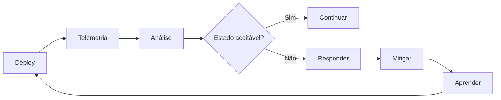
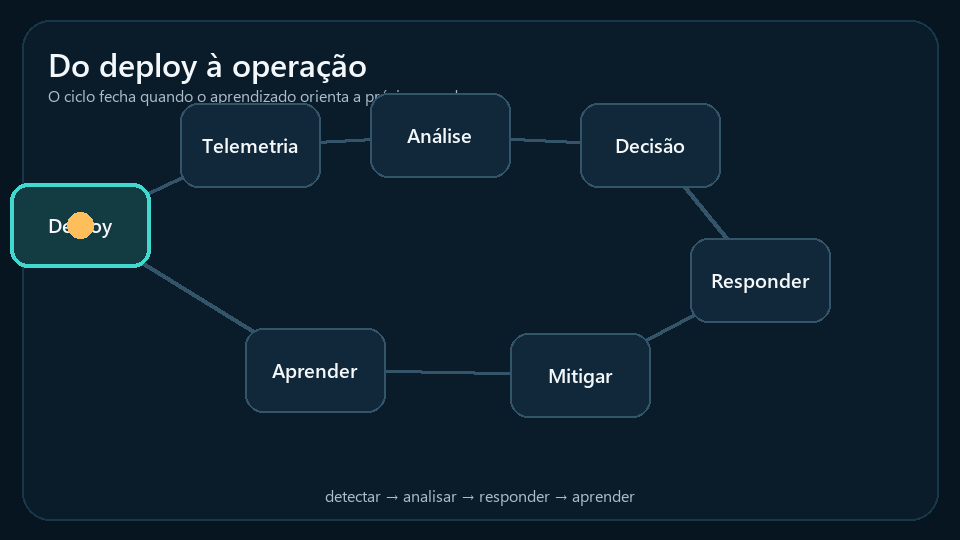
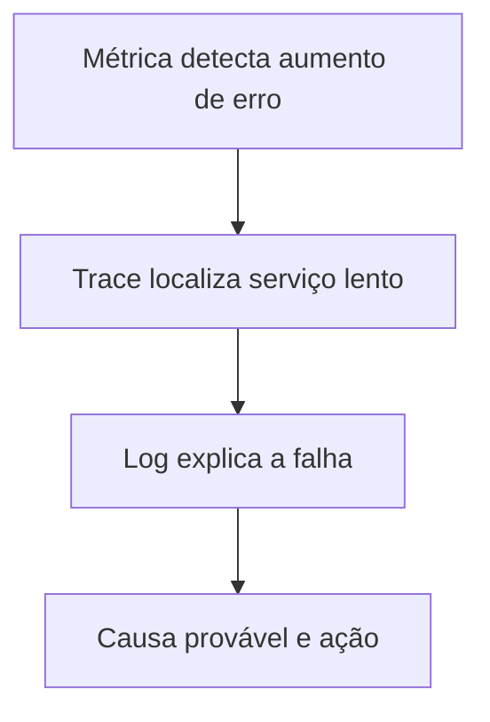
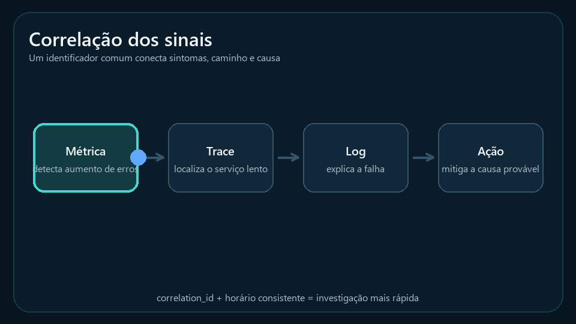
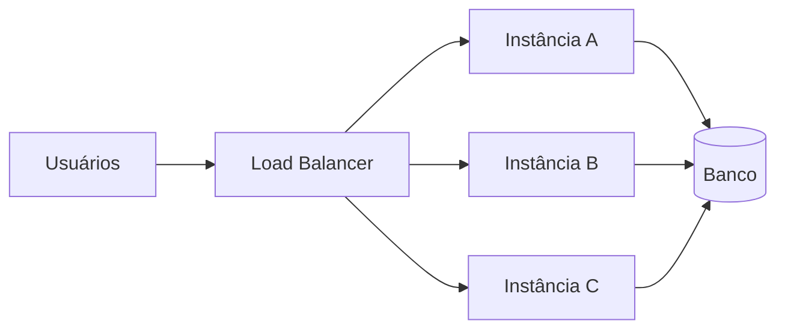
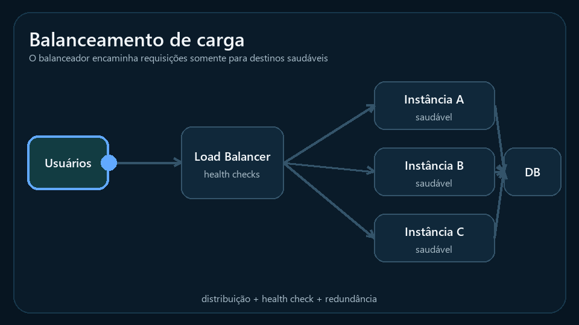
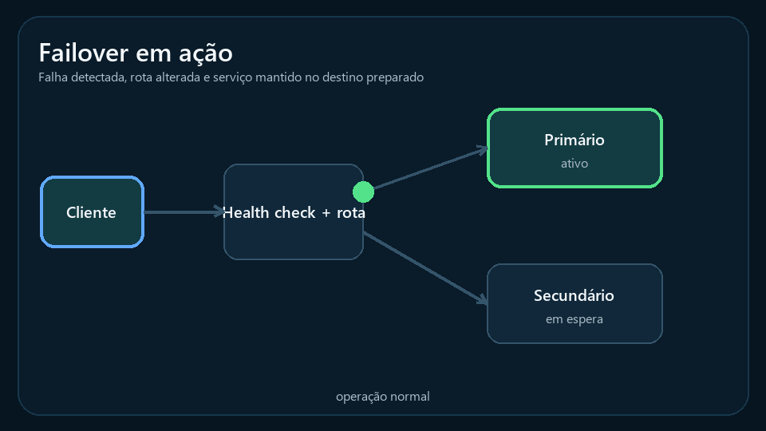
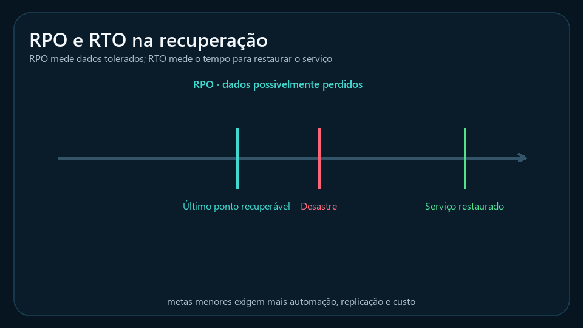
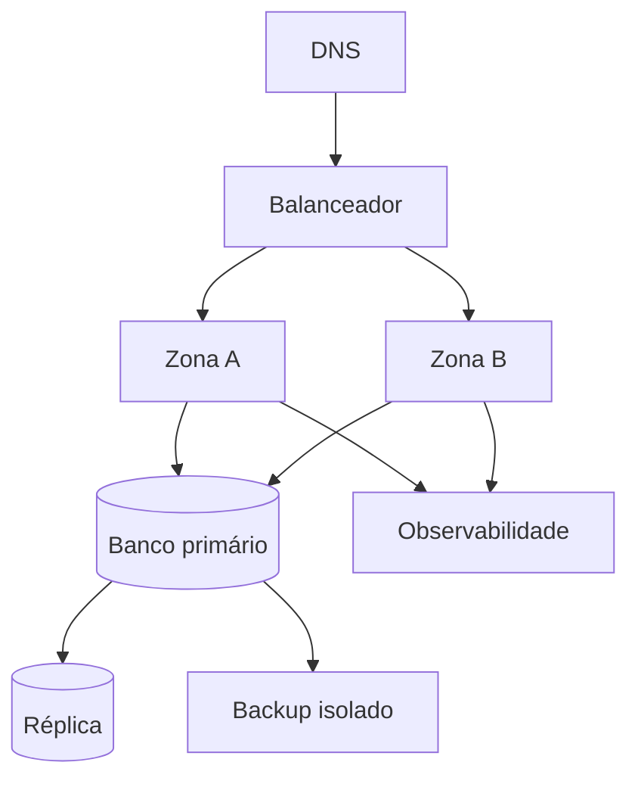
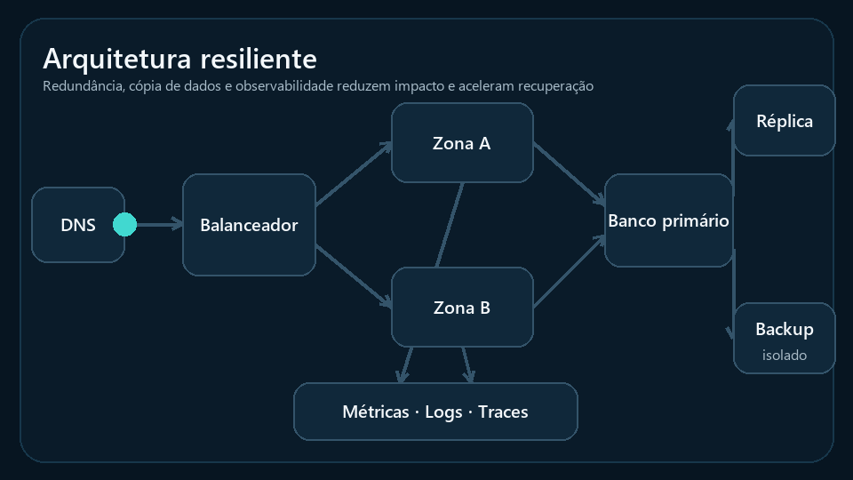

# Aula 12 — Observabilidade, Alta Disponibilidade e Recuperação de Desastres

**Cloud Computing e DevOps Avançado**  
CST em Sistemas para Internet | 6º Período

---

## Slide 1: Abertura

### Aula 12 — Detectar, Resistir e Recuperar

- Observabilidade aplicada
- Alta disponibilidade e resiliência
- Escalabilidade e failover
- Recuperação de desastres
- Entrega do T6 e desenvolvimento do T7

---

## Slide 2: Objetivos

- Correlacionar métricas, logs e traces
- Definir SLIs, SLOs e alertas úteis
- Projetar um painel mínimo
- Diferenciar disponibilidade e resiliência
- Comparar escalabilidade horizontal e vertical
- Definir RPO, RTO e estratégia de recuperação
- Elaborar uma proposta observável e resiliente

---

## Slide 3: Agenda

- Entrega e feedback do T6
- Observabilidade e telemetria
- SLIs, SLOs e alertas
- Painéis e resposta a incidentes
- Escalabilidade e balanceamento
- Redundância, failover e resiliência
- Recuperação de desastres
- Trabalho 7 em sala
- Glossário e referências

---

## Slide 4: T6 — Socialização

- Até 4 minutos por equipe
- Apresentar:
  - Estratégia escolhida
  - Pipeline e gates
  - Critério de promoção
  - Sinal de degradação
  - Gatilho e plano de rollback
- Feedback: o plano é executável sob pressão?

---

## Slide 5: Do Deploy à Operação

*Fluxo animado: a operação gera aprendizado que orienta o próximo deploy.*

---

## Slide 6: Monitoramento e Observabilidade

| Monitoramento | Observabilidade |
|---|---|
| Acompanha condições conhecidas | Investiga comportamento interno |
| Usa perguntas previstas | Permite perguntas novas |
| Aciona alertas | Apoia diagnóstico |
| Pode ser parte da observabilidade | Depende de telemetria contextualizada |

---

## Slide 7: Telemetria

- Dados emitidos pelo sistema
- Principais sinais:
  - Métricas
  - Logs
  - Traces
- Também pode incluir eventos e perfis
- Deve carregar contexto para correlação
- Coletar tudo sem objetivo gera custo e ruído

---

## Slide 8: Métricas

- Séries numéricas ao longo do tempo
- Boas para tendência, agregação e alerta
- Exemplos:
  - Requisições por segundo
  - Taxa de erro
  - Latência p95
  - CPU e memória
  - Tamanho da fila
- Perdem detalhes individuais

---

## Slide 9: Logs

- Registros de eventos
- Devem informar:
  - Momento
  - Serviço
  - Severidade
  - Evento
  - Identificador de correlação
- Evitar dados pessoais e segredos
- Logs estruturados facilitam consulta

---

## Slide 10: Traces Distribuídos

- Acompanham uma requisição entre serviços
- Trace contém spans
- Mostram:
  - Dependências
  - Latências por etapa
  - Erros no caminho
- Essenciais em arquiteturas distribuídas
- Amostragem controla volume e custo

---

## Slide 11: Correlação dos Sinais

*Fluxo animado: cada sinal reduz o espaço de investigação até chegar à ação.*

- Identificadores comuns reduzem tempo de investigação
- Horários e metadados consistentes são fundamentais

---

## Slide 12: SLI

- Service Level Indicator
- Medida quantitativa do serviço
- Exemplos:
  - Proporção de requisições bem-sucedidas
  - Latência abaixo de 300 ms
  - Disponibilidade observada
  - Frescor de dados
- Deve refletir experiência relevante

---

## Slide 13: SLO

- Service Level Objective
- Meta para um SLI em uma janela
- Exemplo:
  - 99,9% das requisições válidas com sucesso em 30 dias
- Direciona decisões de confiabilidade
- Não é automaticamente compromisso contratual

---

## Slide 14: SLA e Error Budget

- SLA: compromisso formal com consequências definidas
- Error budget: indisponibilidade ou falha tolerada pelo SLO
- Se o consumo do orçamento acelera:
  - Reduzir risco de mudanças
  - Priorizar confiabilidade
  - Investigar causas
- Disponibilidade de 100% costuma ter custo impraticável

---

## Slide 15: Exemplo de SLI e SLO

| Item | Definição |
|---|---|
| Serviço | Consulta de catálogo |
| SLI | Requisições válidas concluídas sem erro |
| SLO | 99,9% em janela de 30 dias |
| Latência | 95% abaixo de 400 ms |
| Exclusões | Tráfego inválido explicitamente definido |

---

## Slide 16: Alertas Úteis

- Indicam condição que exige ação
- Possuem:
  - Sintoma
  - Limite
  - Janela
  - Severidade
  - Responsável
  - Runbook
- Alertar tudo gera fadiga
- Preferir impacto ao usuário a ruído interno isolado

---

## Slide 17: Alertar por Sintoma

### Melhor ponto de partida

- Taxa de erro elevada
- Latência degradada
- Operação crítica indisponível
- Orçamento de erro consumido rapidamente

### Complemento

- CPU, disco ou fila ajudam a explicar a causa

---

## Slide 18: Painel Mínimo

- Estado atual do serviço
- Volume
- Erros
- Latência
- Saturação
- Dependências críticas
- Eventos de deploy
- Comparação temporal
- Link para investigação detalhada

---

## Slide 19: Ferramentas do Plano

| Ferramenta | Uso típico |
|---|---|
| CloudWatch | Telemetria em serviços AWS |
| Grafana | Visualização e exploração de dados |
| Datadog | Plataforma integrada de observabilidade |
| Sentry | Erros e desempenho de aplicações |

- Ferramenta não substitui bons sinais e objetivos

---

## Slide 20: Incidente

- Evento que degrada ou interrompe o serviço
- Resposta deve priorizar:
  1. Detectar
  2. Avaliar impacto
  3. Mitigar
  4. Comunicar
  5. Recuperar
  6. Aprender
- Investigar culpados durante a crise atrasa a recuperação

---

## Slide 21: Runbook

- Instrução operacional para situação conhecida
- Deve conter:
  - Sintoma
  - Verificações
  - Ações seguras
  - Escalonamento
  - Reversão
  - Comunicação
- Precisa ser testado e atualizado

---

## Slide 22: Disponibilidade

- Capacidade de o serviço estar acessível quando necessário
- Depende de toda a cadeia
- Componentes redundantes não garantem arquitetura disponível
- Dependências, DNS, banco, rede e operação também contam

---

## Slide 23: Alta Disponibilidade

- Reduz pontos únicos de falha
- Usa redundância e failover
- Distribui instâncias e, quando necessário, zonas
- Automatiza detecção e substituição
- Exige testes de falha
- Aumenta custo e complexidade

---

## Slide 24: Escalabilidade Vertical

- Aumentar recursos de uma instância
- Simples de aplicar
- Possui limite físico ou comercial
- Pode exigir reinicialização
- Mantém concentração de falha
- Útil quando aplicação não escala horizontalmente

---

## Slide 25: Escalabilidade Horizontal

- Aumentar número de instâncias
- Exige distribuição de tráfego
- Favorece redundância
- Aplicação deve tratar estado adequadamente
- Pode automatizar crescimento e redução
- Requer limites para evitar custo descontrolado

---

## Slide 26: Balanceamento de Carga

*Fluxo animado: o balanceador distribui requisições entre instâncias saudáveis.*

- Distribui requisições apenas a destinos saudáveis

---

## Slide 27: Autoscaling

- Ajusta capacidade conforme política
- Sinais possíveis:
  - CPU
  - Requisições
  - Latência
  - Tamanho de fila
- Considerar tempo de inicialização
- Definir mínimo, máximo e cooldown
- Testar comportamento sob carga

---

## Slide 28: Resiliência

- Capacidade de manter ou recuperar função diante de falhas
- Práticas:
  - Timeout
  - Retry com limite
  - Backoff
  - Circuit breaker
  - Bulkhead
  - Degradação graciosa
- Retry sem controle pode amplificar incidente

---

## Slide 29: Failover

- Troca para recurso alternativo
- Pode ser automático ou manual
- Exige:
  - Detecção confiável
  - Destino preparado
  - Dados disponíveis
  - Roteamento
  - Teste periódico
- Um failover nunca testado é apenas uma hipótese

*Fluxo animado: a falha é detectada, a rota muda e o destino preparado assume o tráfego.*

---

## Slide 30: Recuperação de Desastres

- Trata interrupções graves
- Considera perda de região, dados ou infraestrutura
- Inclui:
  - Pessoas
  - Processos
  - Tecnologia
  - Comunicação
  - Testes
- Backup é parte do plano, não o plano completo

---

## Slide 31: RPO

- Recovery Point Objective
- Quantidade máxima aceitável de dados perdidos
- Exemplo:
  - RPO de 15 minutos
- Influencia:
  - Frequência de cópia
  - Replicação
  - Custo
  - Arquitetura de dados

---

## Slide 32: RTO

- Recovery Time Objective
- Tempo máximo desejado para restaurar o serviço
- Exemplo:
  - RTO de 1 hora
- Influencia automação, capacidade reservada e procedimentos
- RTO menor geralmente custa mais

*Fluxo animado: RPO representa a janela de dados tolerada; RTO representa o tempo de recuperação.*

---

## Slide 33: Estratégias de DR

| Estratégia | Recuperação | Custo |
|---|---:|---:|
| Backup e restore | Mais lenta | Baixo |
| Pilot light | Moderada | Médio-baixo |
| Warm standby | Rápida | Médio-alto |
| Active-active | Muito rápida | Alto |

- Seleção deve seguir impacto, RPO e RTO

---

## Slide 34: Backup Confiável

- Possui escopo definido
- É criptografado
- Tem retenção e cópias isoladas
- É monitorado
- Tem restauração testada
- Atende ao RPO
- Não depende apenas do mesmo ambiente que protege

---

## Slide 35: Arquitetura de Referência

*Fluxo animado: redundância, cópia de dados e telemetria trabalham em conjunto.*

---

## Slide 36: Testes de Resiliência

- Simular falha de instância
- Interromper dependência não crítica
- Testar restauração
- Executar failover
- Validar alertas e runbooks
- Medir tempo real de recuperação
- Começar em ambiente controlado

---

## Slide 37: Trabalho 7 — Contexto

- Tema:
  - Observabilidade, disponibilidade e recuperação
- Valor:
  - Até 1,0 ponto
- Desenvolvimento e entrega:
  - Nesta Aula 12
- Base:
  - Mesmo serviço utilizado no T6

---

## Slide 38: T7 — Entregáveis

- Diagrama da arquitetura
- Três ou mais SLIs
- Dois SLOs
- Painel mínimo proposto
- Três alertas com ação
- Estratégia de alta disponibilidade
- RPO e RTO justificados
- Estratégia de DR
- Runbook resumido de uma falha

---

## Slide 39: T7 — Critérios

| Critério | Valor |
|---|---:|
| SLIs, SLOs, painel e alertas |  |
| Arquitetura de disponibilidade e resiliência |  |
| RPO, RTO e estratégia de DR |  |
| Runbook, riscos e justificativas |  |
| Organização e apresentação |  |
| **Total** | **1,00** |

---

## Slide 40: T7 — Roteiro de Execução

1. Selecionar operação crítica
2. Definir experiência esperada
3. Criar SLIs e SLOs
4. Selecionar sinais e alertas
5. Desenhar redundância e failover
6. Definir RPO e RTO
7. Selecionar estratégia de DR
8. Criar runbook
9. Revisar e entregar

---

## Slide 41: T7 — Apresentação

- Uma equipe será sorteada
- Até 6 minutos
- Demonstrar:
  - SLO principal
  - Painel
  - Alerta acionável
  - Arquitetura HA
  - RPO/RTO
  - Resposta a uma falha

---

## Slide 42: Glossário — Observabilidade

| Termo | Significado |
|---|---|
| **Telemetria** | Dados emitidos pelo sistema |
| **SLI** | Indicador quantitativo do serviço |
| **SLO** | Meta para um SLI em uma janela |
| **SLA** | Compromisso formal de nível de serviço |
| **Error budget** | Falha tolerada pelo objetivo definido |
| **Runbook** | Procedimento operacional documentado |

---

## Slide 43: Glossário — Resiliência

| Termo | Significado |
|---|---|
| **HA** | Alta disponibilidade |
| **Failover** | Troca para recurso alternativo |
| **Autoscaling** | Ajuste automático de capacidade |
| **RPO** | Perda máxima de dados tolerada |
| **RTO** | Tempo-alvo para recuperação |
| **DR** | Recuperação de desastres |

---

## Slide 44: Referências

- KOLBE JÚNIOR, Armando. *Computação em Nuvem*. Contentus, 2020.
- SOUSA NETO, Manoel Veras de. *Computação em Nuvem*. Brasport, 2015.
- GOOGLE. *Site Reliability Engineering*. <https://sre.google/books/>
- OPENTELEMETRY. *Documentation*. <https://opentelemetry.io/docs/>
- AWS. *Disaster Recovery of Workloads on AWS*. <https://docs.aws.amazon.com/whitepapers/latest/disaster-recovery-workloads-on-aws/disaster-recovery-options-in-the-cloud.html>

---

## Slide 45: Síntese

- Observabilidade reduz tempo de detecção e diagnóstico
- SLO traduz confiabilidade em objetivo
- Alertas precisam exigir ação
- Alta disponibilidade reduz interrupções locais
- Resiliência controla efeitos de falhas
- DR prepara recuperação de eventos graves
- RPO e RTO conectam tecnologia e impacto

---

## Slide 46: Próxima Aula

### Aula 13

- Segurança em nuvem
- IAM e menor privilégio
- Auditoria e compliance
- DevSecOps
- Zero Trust
- FinOps e otimização de custos
- Desenvolvimento e entrega do T8

---

## Slide 47: Perguntas

- Que sinal representa melhor a experiência do usuário?
- Seu alerta indica uma ação concreta?
- Onde existe ponto único de falha?
- O RPO é compatível com a cópia de dados?
- Quando o plano de restauração foi testado?

---

## Slide 48: Encerramento

- T6 entregue
- T7 desenvolvido e entregue em sala
- Guardar os diagramas e decisões para a revisão
- Relacionar confiabilidade, risco e custo na próxima aula
