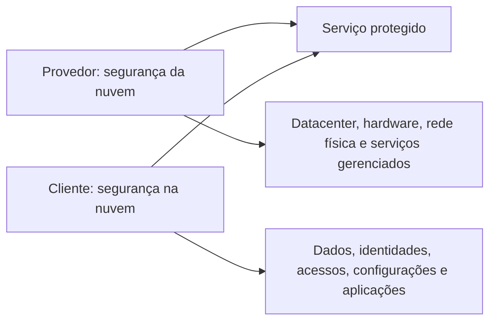
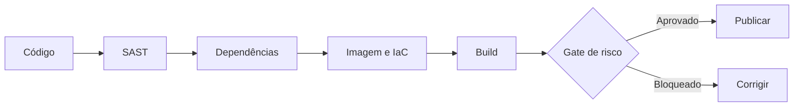
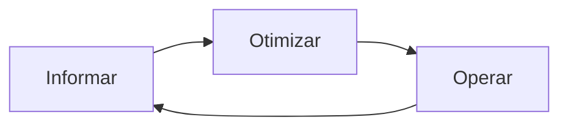
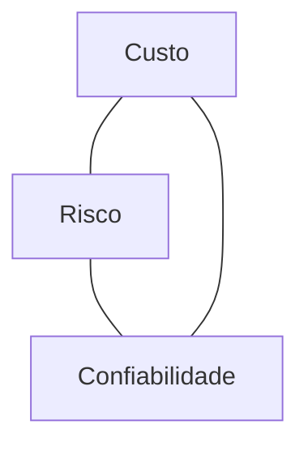

# Aula 13 — Segurança, DevSecOps, Zero Trust e FinOps

**Cloud Computing e DevOps Avançado**  
CST em Sistemas para Internet | 6º Período

---

## Slide 1: Abertura

### Aula 13 — Proteger e Otimizar Sistemas em Nuvem

- Segurança em nuvem
- IAM, auditoria e compliance
- DevSecOps e Zero Trust
- FinOps
- Desenvolvimento e entrega do Trabalho 8

---

## Slide 2: Objetivos

- Aplicar o modelo de responsabilidade compartilhada
- Projetar permissões pelo menor privilégio
- Diferenciar autenticação e autorização
- Integrar segurança ao pipeline
- Explicar princípios de Zero Trust
- Relacionar auditoria e compliance
- Analisar custos e propor otimizações responsáveis

---

## Slide 3: Agenda

- Risco em nuvem
- Responsabilidade compartilhada
- Identidade, acesso e segredos
- Proteção de dados e rede
- Auditoria e compliance
- DevSecOps e cadeia de suprimentos
- Zero Trust
- FinOps
- Trabalho 8 em sala
- Glossário e referências

---

## Slide 4: Segurança como Propriedade do Sistema

- Pessoas, processos e tecnologia participam
- Segurança tardia aumenta custo de correção
- Automação reduz variação, não elimina risco
- Controle precisa ser proporcional ao impacto
- Evidências sustentam auditoria e aprendizagem
- Disponibilidade e custo também fazem parte da decisão

---

## Slide 5: Modelo de Responsabilidade Compartilhada

- O provedor protege **a infraestrutura que sustenta a nuvem**
- O cliente protege **o que implanta, configura e armazena na nuvem**
- A responsabilidade não desaparece: ela muda conforme o modelo de serviço
- Quanto mais gerenciado o serviço, mais tarefas operacionais passam ao provedor
- Dados, identidades, classificação das informações e decisões de acesso continuam sob responsabilidade do cliente
- Uma falha pode envolver os dois lados, exigindo evidências e cooperação

---

## Slide 6: Responsabilidade em IaaS, PaaS e SaaS

| Camada | IaaS | PaaS | SaaS |
|---|---|---|---|
| Infraestrutura física | Provedor | Provedor | Provedor |
| Sistema operacional | Cliente | Provedor | Provedor |
| Runtime e middleware | Cliente | Provedor | Provedor |
| Aplicação | Cliente | Cliente | Provedor |
| Configuração do serviço | Cliente | Cliente | Cliente |
| Dados, usuários e permissões | Cliente | Cliente | Cliente |

### Exemplo prático

- Em uma VM, o provedor protege o datacenter e o hypervisor; a equipe deve atualizar o sistema operacional, fechar portas e proteger a aplicação
- Em um banco gerenciado, o provedor atualiza o mecanismo; a equipe ainda define usuários, permissões, exposição de rede, backup e proteção dos dados
- Em um SaaS, o fornecedor opera a aplicação; a organização ainda controla contas, MFA, compartilhamentos e informações inseridas

---

## Slide 7: Ameaça, Vulnerabilidade e Risco

| Conceito | Significado |
|---|---|
| Ameaça | Evento ou agente capaz de causar dano |
| Vulnerabilidade | Fraqueza explorável |
| Impacto | Consequência para o negócio |
| Probabilidade | Possibilidade de ocorrência |
| Risco | Combinação de probabilidade e impacto |

---

## Slide 8: Defesa em Profundidade

- Múltiplas camadas de controle
- Exemplos:
  - Identidade
  - Rede
  - Aplicação
  - Dados
  - Monitoramento
  - Recuperação
- Uma camada não deve depender da perfeição das demais

### Exemplo prático

- Uma senha vazada não resulta imediatamente em invasão porque ainda existem MFA, menor privilégio, segmentação, alertas e registros de auditoria

---

## Slide 9: IAM

- Identity and Access Management
- Responde:
  - Quem é a identidade?
  - O que pode fazer?
  - Sobre qual recurso?
  - Em que condição?
- Inclui usuários, grupos, papéis, políticas e identidades de serviço

### Exemplo prático

- Um desenvolvedor pode consultar logs do ambiente de testes, mas não excluir recursos de produção
- O pipeline recebe uma identidade própria para publicar imagens, sem utilizar a conta pessoal de um integrante

---

## Slide 10: Autenticação e Autorização

| Autenticação | Autorização |
|---|---|
| Confirma identidade | Decide acesso permitido |
| Senha, chave, certificado, MFA | Política, papel e atributo |
| “Quem é?” | “O que pode fazer?” |

- Identidade autenticada não deve receber acesso irrestrito

---

## Slide 11: Menor Privilégio

- Conceder apenas ações necessárias
- Restringir recursos e condições
- Preferir acesso temporário
- Revisar permissões não utilizadas
- Separar funções críticas
- Evitar credenciais compartilhadas
- Registrar alterações

### Exemplo prático

- Em vez de conceder administração total ao pipeline, permitir somente publicar uma imagem em um repositório específico
- Para uma manutenção emergencial, liberar acesso elevado por 30 minutos e revogá-lo automaticamente

---

## Slide 12: Matriz IAM

| Identidade | Recurso | Ação | Condição |
|---|---|---|---|
| Pipeline CI | Registro | Publicar imagem | Branch principal |
| Aplicação | Banco | Ler e gravar schema próprio | Ambiente de produção |
| Observabilidade | Logs | Ler | Conta de operação |
| Auditor | Trilhas | Ler | MFA obrigatório |

---

## Slide 13: RBAC e ABAC

- RBAC: acesso por função ou papel
- ABAC: acesso por atributos e condições
- RBAC facilita responsabilidades conhecidas
- ABAC permite contexto mais dinâmico
- Políticas excessivamente complexas dificultam auditoria
- Escolha deve equilibrar precisão e governança

---

## Slide 14: MFA e Acesso Privilegiado

- MFA reduz risco de credencial roubada
- Contas administrativas exigem proteção adicional
- Acesso privilegiado deve ser:
  - Temporário
  - Justificado
  - Aprovado quando necessário
  - Registrado
  - Revogado após uso

---

## Slide 15: Identidades de Serviço

- Aplicações também possuem identidade
- Evitar chaves permanentes
- Preferir credenciais de curta duração e papéis do ambiente
- Uma identidade por responsabilidade
- Restringir acesso ao recurso necessário
- Rotacionar e monitorar

---

## Slide 16: Gestão de Segredos

- Armazenar em cofre ou serviço apropriado
- Não inserir em código, imagem ou log
- Criptografar em trânsito e repouso
- Controlar acesso e auditar uso
- Rotacionar
- Revogar imediatamente após exposição

### Exemplo prático

- A senha do banco fica em um cofre de segredos e é obtida pela aplicação durante a execução
- Se uma chave for enviada acidentalmente ao GitHub, removê-la do arquivo não basta: a chave deve ser revogada e substituída

---

## Slide 17: Proteção de Dados

- Classificar dados
- Minimizar coleta e retenção
- Criptografar
- Controlar acesso
- Manter backup e recuperação
- Mascarar informações sensíveis
- Definir descarte seguro
- Respeitar requisitos legais e contratuais

---

## Slide 18: Segurança de Rede

- Segmentar ambientes e cargas
- Restringir entrada e saída
- Usar conexões privadas quando apropriado
- Proteger borda com WAF e controles de negação de serviço
- Criptografar tráfego
- Registrar fluxos relevantes
- Não confiar apenas no perímetro

### Exemplo prático

- A aplicação web recebe tráfego HTTPS da internet, mas o banco aceita conexão apenas da aplicação em uma rede privada
- Um WAF bloqueia padrões suspeitos, enquanto logs de fluxo ajudam a investigar tentativas de acesso

---

## Slide 19: Auditoria

- Registro de ações relevantes
- Deve responder:
  - Quem?
  - O quê?
  - Quando?
  - Onde?
  - Resultado?
- Logs precisam de integridade, retenção e acesso controlado
- Alertas devem cobrir ações críticas

### Exemplo prático

- A exclusão de um bucket deve registrar identidade, horário, endereço de origem, recurso afetado e resultado
- A criação de uma conta administrativa fora do processo normal gera um alerta imediato

---

## Slide 20: Compliance

- Atendimento a normas, leis e contratos
- Não é sinônimo de segurança total
- Exige:
  - Controles
  - Evidências
  - Responsáveis
  - Revisões
  - Tratamento de desvios
- Automação pode produzir evidências continuamente

---

## Slide 21: DevSecOps

- Segurança integrada ao ciclo de entrega
- Responsabilidade compartilhada
- Feedback cedo
- Controles automatizados
- Exceções explícitas e rastreáveis
- Correção orientada por risco
- Segurança como parte da Definition of Done

### Exemplo prático

- Um commit com segredo exposto é bloqueado antes do merge
- Uma dependência com vulnerabilidade crítica impede a publicação, enquanto uma vulnerabilidade de baixo risco gera tarefa com prazo definido

---

## Slide 22: Shift Left e Shift Right

| Shift left | Shift right |
|---|---|
| Prevenir cedo | Observar em execução |
| Revisão e testes no pipeline | Detecção e resposta |
| SAST, dependências, IaC | WAF, runtime e telemetria |

- Um não substitui o outro

---

## Slide 23: Controles no Pipeline

---

## Slide 24: SAST, DAST e SCA

| Controle | Foco |
|---|---|
| SAST | Código sem executar |
| DAST | Aplicação em execução |
| SCA | Dependências e componentes |
| IaC scan | Infraestrutura como código |
| Secret scan | Credenciais expostas |

- Resultados precisam de triagem e prioridade

---

## Slide 25: Segurança de Containers

- Imagem mínima e de origem confiável
- Dependências atualizadas
- Usuário não privilegiado
- Sistema de arquivos somente leitura quando possível
- Capabilities reduzidas
- Imagem assinada e rastreável
- Varredura antes da publicação
- Proteção também em runtime

### Exemplo prático

- A imagem da Biblioteca utiliza uma imagem-base mínima, executa com usuário sem privilégios e recebe a senha do banco por secret
- O pipeline bloqueia imagens com vulnerabilidades críticas conhecidas antes do envio ao registry

---

## Slide 26: Cadeia de Suprimentos

- Código, dependências, ferramentas e artefatos formam a cadeia
- Riscos:
  - Pacote comprometido
  - Pipeline alterado
  - Runner invadido
  - Artefato substituído
- Controles:
  - Proveniência
  - Assinatura
  - Revisão
  - Dependências fixadas
  - Menor privilégio

---

## Slide 27: Zero Trust

- Nunca confiar implicitamente
- Verificar explicitamente
- Aplicar menor privilégio
- Assumir possibilidade de comprometimento
- Decisão considera identidade, dispositivo, recurso e contexto
- Acesso é continuamente avaliado

### Exemplo prático

- Um administrador autenticado com MFA acessa produção somente por dispositivo gerenciado, em horário autorizado e com permissão temporária
- Se o dispositivo perder conformidade ou surgir comportamento anômalo, a sessão pode exigir nova verificação ou ser encerrada

---

## Slide 28: Zero Trust não Significa

- Bloquear tudo indiscriminadamente
- Comprar uma única ferramenta
- Eliminar usabilidade
- Ignorar rede
- Confiar permanentemente após login

### Significa

Decisões explícitas, contextuais e verificáveis.

---

## Slide 29: Resposta a Incidentes de Segurança

1. Detectar
2. Conter
3. Preservar evidências
4. Erradicar causa
5. Recuperar
6. Comunicar
7. Aprender

- Runbooks e responsabilidades reduzem atraso
- Obrigações legais devem ser conhecidas previamente

---

## Slide 30: O que é FinOps?

- Prática colaborativa de gestão do valor da nuvem
- Aproxima engenharia, finanças e negócio
- Busca decisões orientadas por valor
- Combina visibilidade, responsabilidade e otimização
- Não significa apenas cortar custos

### Exemplo prático

- Uma instância maior pode custar mais, mas ser a escolha correta se sustentar o SLO durante um período de alta demanda
- Um ambiente de testes desligado fora do horário reduz desperdício sem comprometer a produção

---

## Slide 31: Ciclo FinOps

- Informar: visibilidade e alocação
- Otimizar: eliminar desperdício e escolher compromisso
- Operar: incorporar decisões continuamente

---

## Slide 32: Visibilidade de Custos

- Tags e labels consistentes
- Conta, projeto e ambiente separados
- Centro de custo e produto
- Dono técnico e responsável financeiro
- Dashboards e orçamento
- Custo unitário por transação ou usuário
- Recursos sem proprietário devem ser investigados

### Exemplo prático

- Tags como `produto=biblioteca`, `ambiente=teste`, `equipe=backend` e `centro-custo=si` permitem separar e atribuir as despesas
- O custo por empréstimo processado mostra se o gasto cresce proporcionalmente ao valor entregue

---

## Slide 33: Principais Vetores de Custo

- Computação
- Armazenamento
- Banco de dados
- Tráfego de saída
- Observabilidade e retenção
- Licenças
- Recursos ociosos
- Capacidade excessiva
- Arquitetura multicloud sem necessidade

---

## Slide 34: Otimização Responsável

- Rightsizing
- Autoscaling
- Desligamento programado
- Classes adequadas de armazenamento
- Retenção consciente de logs
- Compromissos para uso previsível
- Remoção de recursos órfãos
- Otimizar sem violar SLO, segurança ou recuperação

### Exemplos práticos

- Reduzir uma VM com CPU média de 8%, depois de validar picos e margem de segurança
- Mover backups antigos para uma classe de armazenamento mais barata
- Reduzir retenção de logs de depuração, preservando logs de auditoria pelo prazo exigido
- Usar autoscaling para responder à demanda sem manter capacidade máxima permanentemente

---

## Slide 35: Custo, Risco e Confiabilidade

- Reduzir redundância pode diminuir custo e elevar risco
- Retenção excessiva aumenta custo
- Controle insuficiente pode gerar perda muito maior
- Decisão deve explicitar o trade-off

---

## Slide 36: Orçamento e Alertas

- Definir orçamento por escopo
- Alertar antes de esgotar
- Detectar anomalias
- Informar responsável
- Relacionar variação a deploy ou demanda
- Evitar desligamento automático de serviço crítico sem política

---

## Slide 37: Caso Integrado

- Aplicação Biblioteca em nuvem
- Pipeline publica imagem
- Kubernetes executa o serviço
- Dados pessoais de usuários
- Logs crescem rapidamente
- Equipe compartilha uma credencial administrativa
- Recursos de teste ficam ativos continuamente
- Objetivo: reduzir risco e custo

---

## Slide 38: Trabalho 8 — Contexto

- Tema:
  - Segurança, DevSecOps e FinOps aplicados
- Valor:
  - Até 1,0 ponto
- Desenvolvimento e entrega:
  - Nesta Aula 13
- Base:
  - Aplicação Biblioteca ou caso autorizado

---

## Slide 39: T8 — Entregáveis

- Diagrama de contexto
- Matriz IAM com menor privilégio
- Política de segredos
- Controles do pipeline
- Checklist de containers e dados
- Plano de auditoria
- Aplicação de princípios Zero Trust
- Estimativa dos principais custos
- Cinco ações de otimização justificadas

---

## Slide 40: T8 — Critérios

| Critério | Valor |
|---|---:|
| IAM, segredos e proteção de dados |  |
| DevSecOps e controles do pipeline |  |
| Auditoria, compliance e Zero Trust |  |
| Visibilidade e otimização de custos |  |
| Coerência, organização e apresentação |  |
| **Total** | **1,00** |

---

## Slide 41: T8 — Roteiro

1. Identificar dados, recursos e identidades
2. Mapear ameaças e riscos
3. Criar matriz IAM
4. Definir controles preventivos e detectivos
5. Inserir gates no pipeline
6. Planejar auditoria
7. Aplicar Zero Trust
8. Mapear custos
9. Priorizar otimizações

---

## Slide 42: T8 — Apresentação

- Uma equipe será sorteada
- Até 6 minutos
- Apresentar:
  - Maior risco
  - Permissão crítica
  - Controle do pipeline
  - Evidência de auditoria
  - Decisão Zero Trust
  - Maior custo e otimização

---

## Slide 43: Glossário — Segurança

| Termo | Significado |
|---|---|
| **IAM** | Gestão de identidades e acessos |
| **MFA** | Autenticação por múltiplos fatores |
| **RBAC** | Controle de acesso baseado em papéis |
| **ABAC** | Controle de acesso baseado em atributos |
| **Menor privilégio** | Apenas permissões necessárias |
| **Compliance** | Atendimento a requisitos aplicáveis |

---

## Slide 44: Glossário — DevSecOps e Custos

| Termo | Significado |
|---|---|
| **DevSecOps** | Segurança integrada ao ciclo DevOps |
| **SAST** | Análise estática de segurança |
| **DAST** | Teste dinâmico de segurança |
| **SCA** | Análise de componentes de software |
| **Zero Trust** | Verificação explícita e contínua |
| **FinOps** | Gestão colaborativa do valor da nuvem |
| **Rightsizing** | Ajuste de recursos à necessidade |

---

## Slide 45: Referências

- MUNIZ, Antonio; IRIGOYEN, Analia. *Jornada DevOps*. Brasport, 2020.
- FREEMAN, Emily. *DevOps para leigos*. Alta Books, 2021.
- NIST. *Zero Trust Architecture*. <https://csrc.nist.gov/publications/detail/sp/800-207/final>
- OWASP. *DevSecOps Guideline*. <https://owasp.org/www-project-devsecops-guideline/>
- FINOPS FOUNDATION. *FinOps Framework*. <https://www.finops.org/framework/>

---

## Slide 46: Síntese

- Segurança é responsabilidade compartilhada
- IAM começa por identidade e menor privilégio
- DevSecOps antecipa feedback e mantém proteção em runtime
- Zero Trust elimina confiança implícita
- Auditoria exige evidências confiáveis
- FinOps otimiza valor, não apenas despesa
- Custo, risco e confiabilidade precisam ser equilibrados

---

## Slide 47: Próxima Aula

### Aula 14 — Revisão e Consolidação

- Cloud e arquiteturas
- Containers e Kubernetes
- CI/CD
- Observabilidade
- Alta disponibilidade e DR
- Segurança, DevSecOps e FinOps
- Simulado e correção comentada

---

## Slide 48: Checklist de Preparação

- Revisar Aulas 09 a 13
- Organizar entregas T5 a T8
- Revisar diagramas e glossários
- Refazer decisões dos estudos de caso
- Relacionar cada prática a risco, evidência e resultado

---

## Slide 49: Encerramento

- T8 desenvolvido e entregue
- Trabalhos do segundo bimestre totalizam até 4,0 pontos
- Próxima aula dedicada à revisão
- Pergunta final:
  - Qual controle reduz mais risco sem impedir a entrega de valor?

