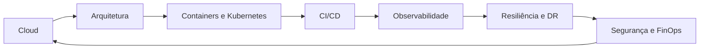
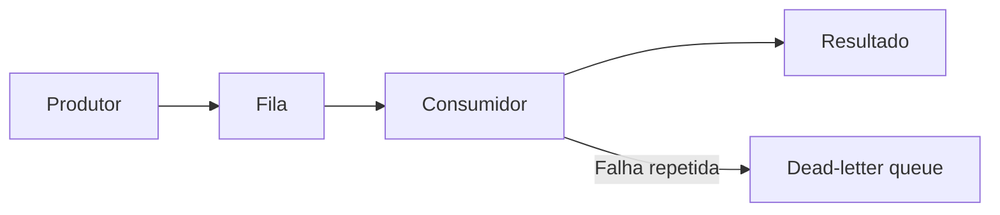

# Aula 14 — Revisão e Consolidação do Segundo Bimestre

**Cloud Computing e DevOps Avançado**  
CST em Sistemas para Internet | 6º Período

---

## Slide 1: Abertura

### Aula 14 — Da Arquitetura à Operação Confiável

- Revisão integrada
- Estudos de caso
- Simulado
- Correção comentada
- Fechamento do segundo bimestre

---

## Slide 2: Objetivos

- Consolidar os principais conceitos da disciplina
- Relacionar arquitetura, entrega e operação
- Comparar decisões e trade-offs
- Revisar os trabalhos T5 a T8
- Resolver questões conceituais e aplicadas
- Identificar pontos que exigem estudo adicional

---

## Slide 3: Agenda

- Mapa geral da disciplina
- Revisão do primeiro bimestre
- DevOps e CI/CD
- Observabilidade e confiabilidade
- Segurança e FinOps
- Caso integrado
- Simulado
- Correção comentada
- Preparação para avaliação

---

## Slide 4: Mapa da Disciplina

---

## Slide 5: Princípio Integrador

- Uma decisão técnica afeta:
  - Velocidade de entrega
  - Disponibilidade
  - Segurança
  - Custo
  - Operação
- Não existe arquitetura “melhor” sem contexto
- Trade-offs precisam ser explícitos e observáveis

**Exemplo:** manter duas regiões pode reduzir o risco de indisponibilidade, mas aumenta custo, replicação de dados e complexidade operacional.

---

## Slide 6: Modelos de Serviço

| Modelo | Cliente controla mais | Provedor controla mais |
|---|---|---|
| IaaS | SO, runtime e aplicação | Infraestrutura física |
| PaaS | Aplicação e dados | Plataforma e infraestrutura |
| SaaS | Uso, identidades e dados aplicáveis | Aplicação e infraestrutura |

- Responsabilidade compartilhada permanece em todos

**Exemplo:** em IaaS, a equipe atualiza o sistema operacional da VM; em PaaS, concentra-se na aplicação; em SaaS, administra principalmente usuários, acessos e dados sob seu controle.

---

## Slide 7: Regiões e Zonas

- Região: área geográfica
- Zona: domínio de falha dentro da região
- Múltiplas zonas reduzem falha local
- Múltiplas regiões ampliam resiliência e custo
- Latência, soberania e serviços disponíveis influenciam a escolha

**Exemplo:** uma aplicação brasileira pode usar duas zonas na mesma região para tolerar falha zonal sem introduzir a latência de uma região distante.

---

## Slide 8: Escalabilidade

| Vertical | Horizontal |
|---|---|
| Mais recursos por instância | Mais instâncias |
| Simples, mas limitada | Elástica, porém exige arquitetura adequada |
| Pode manter ponto único | Favorece redundância |

- Autoscaling precisa de sinal, limites e tempo de reação

**Exemplo:** durante as matrículas, a aplicação cresce de 3 para 10 instâncias quando a fila e a latência ultrapassam os limites definidos.

---

## Slide 9: Microserviços

- Serviços com responsabilidades delimitadas
- Implantação e evolução independentes quando possível
- Benefícios:
  - Autonomia
  - Escalabilidade seletiva
- Custos:
  - Rede
  - Observabilidade
  - Consistência
  - Operação
- Monólito bem estruturado continua opção válida

**Exemplo:** separar pagamentos do catálogo permite escalar e proteger o serviço crítico, mas exige lidar com rede, falhas parciais e rastreamento distribuído.

---

## Slide 10: Containers

- Imagem: pacote imutável e versionado
- Container: execução isolada da imagem
- Registro: armazenamento e distribuição
- `Dockerfile`: receita de construção
- Boas práticas:
  - Imagem mínima
  - Usuário não root
  - Segredos externos
  - Tags rastreáveis

**Exemplo:** `biblioteca:4f92ac1` identifica a imagem pelo commit, enquanto `latest` não informa exatamente qual código foi implantado.

---

## Slide 11: Kubernetes

| Objeto | Função |
|---|---|
| Pod | Unidade de execução |
| Deployment | Estado desejado e atualizações |
| Service | Acesso estável aos Pods |
| ConfigMap | Configuração não sensível |
| Secret | Dados sensíveis com controle adequado |
| Ingress | Entrada HTTP/HTTPS conforme controlador |

**Exemplo:** o Deployment mantém três Pods da biblioteca; o Service oferece um endereço estável mesmo quando esses Pods são substituídos.

---

## Slide 12: Serviços em Nuvem

- Compute: VMs, containers e serverless
- Storage: objetos, blocos e arquivos
- Bancos: SQL e NoSQL gerenciados
- CDN: conteúdo próximo ao usuário
- Filas e pub/sub: desacoplamento
- Escolha deve considerar padrão de acesso, consistência, escala e custo

**Exemplo:** capas de livros podem ir para object storage e CDN; dados de empréstimos permanecem em banco relacional gerenciado.

---

## Slide 13: Processamento Assíncrono

- Reduz acoplamento temporal
- Exige idempotência, retry e observabilidade

**Exemplo:** a API registra um empréstimo e publica uma mensagem; outro serviço envia o e-mail sem atrasar a resposta ao usuário.

---

## Slide 14: Cultura DevOps

- Colaboração entre desenvolvimento, operações, segurança e negócio
- Automação
- Fluxo de valor
- Feedback rápido
- Responsabilidade compartilhada
- Aprendizagem contínua
- DevOps não é apenas cargo ou ferramenta

**Exemplo:** desenvolvimento, operações e segurança definem juntos o pipeline e acompanham o comportamento da versão em produção.

---

## Slide 15: Pipeline

- Sequência automatizada e versionada
- Contém:
  - Gatilho
  - Checkout
  - Build
  - Testes
  - Segurança
  - Artefato
  - Promoção
  - Evidências
- Falha deve interromper avanço inseguro

**Exemplo:** se testes ou análise de vulnerabilidades falharem, a imagem não é promovida ao ambiente de produção.

---

## Slide 16: Integração Contínua

- Mudanças pequenas e frequentes
- Build reprodutível
- Testes automatizados
- Feedback rápido
- Branch compartilhada saudável
- Artefato associado ao commit
- Cache acelera; artefato preserva saída

**Exemplo:** dependências Maven podem usar cache regenerável, enquanto o arquivo `.jar` aprovado é armazenado como artefato versionado.

---

## Slide 17: CI, Entrega e Implantação

| CI | Entrega contínua | Implantação contínua |
|---|---|---|
| Integra e verifica | Mantém pronto para produção | Implanta automaticamente |
| Produz artefato | Promove com controles | Automatiza passagem final |

**Exemplo:** a CI gera e testa a imagem; a entrega contínua deixa essa imagem pronta; a implantação contínua pode promovê-la automaticamente após os gates.

---

## Slide 18: Estratégias de Deploy

| Estratégia | Característica |
|---|---|
| Recreate | Substituição com possível interrupção |
| Rolling | Troca gradual de instâncias |
| Blue/green | Ambientes paralelos e troca de rota |
| Canary | Exposição gradual por tráfego |

- Escolha depende de risco, custo e observabilidade

**Exemplo:** uma correção de baixo risco pode usar rolling; uma mudança crítica em pagamentos pode começar como canary com 5% do tráfego.

---

## Slide 19: Rollback e Dados

- Rollback precisa ser planejado
- Artefato anterior deve permanecer disponível
- Configuração precisa ser rastreável
- Banco pode impedir reversão simples
- Migração expandir/contrair preserva compatibilidade
- Roll forward pode ser mais seguro em alguns casos

**Exemplo:** adicionar uma coluna opcional antes de usá-la permite que versões antiga e nova coexistam durante rolling ou blue/green.

---

## Slide 20: Observabilidade

- Métricas: tendências e alertas
- Logs: detalhes de eventos
- Traces: caminho distribuído
- Correlação reduz tempo de diagnóstico
- Telemetria deve responder perguntas úteis
- Volume sem propósito aumenta custo

**Exemplo:** uma requisição lenta pode ser localizada combinando métrica de latência, `trace_id` e o log do serviço que falhou.

---

## Slide 21: SLI, SLO e SLA

| Termo | Função |
|---|---|
| SLI | Medida observada |
| SLO | Meta para a medida |
| SLA | Compromisso formal |
| Error budget | Falha tolerada pelo SLO |

**Exemplo:** se o SLI mensal de disponibilidade é 99,93% e o SLO é 99,90%, ainda existe uma pequena margem no error budget.

---

## Slide 22: Alertas

- Precisam ser acionáveis
- Preferir sintomas de impacto
- Definir janela e severidade
- Indicar responsável e runbook
- Evitar fadiga de alertas
- Revisar falsos positivos e alertas ausentes

**Exemplo:** alertar quando erros comprometem o SLO é mais útil do que notificar toda vez que a CPU ultrapassa 50% por poucos segundos.

---

## Slide 23: Alta Disponibilidade

- Eliminar pontos únicos de falha
- Redundância em domínios independentes
- Balanceamento e health checks
- Failover testado
- Dados disponíveis
- Capacidade suficiente
- Custo proporcional ao requisito

**Exemplo:** três réplicas em zonas diferentes não garantem HA se todas ainda dependerem de um banco em uma única zona.

---

## Slide 24: Resiliência

- Timeout
- Retry com backoff e limite
- Circuit breaker
- Bulkhead
- Idempotência
- Degradação graciosa
- Testes de falha
- Observação do comportamento

**Exemplo:** um circuit breaker interrompe temporariamente chamadas a um serviço de terceiros instável, evitando saturar toda a aplicação.

---

## Slide 25: RPO e RTO

- RPO: perda máxima de dados tolerada
- RTO: tempo-alvo de recuperação
- Precisam vir do impacto de negócio
- Orientam:
  - Replicação
  - Backup
  - Automação
  - Capacidade alternativa
  - Testes

**Exemplo:** RPO de 5 minutos limita a perda de dados; RTO de 30 minutos define quanto tempo o serviço pode levar para voltar.

---

## Slide 26: Estratégias de DR

- Backup e restore
- Pilot light
- Warm standby
- Active-active
- Menor RTO/RPO costuma elevar custo e complexidade
- Restauração e failover devem ser exercitados

**Exemplo:** warm standby mantém uma versão reduzida do ambiente pronta para ampliar, custando mais que backup e restore, mas recuperando mais rápido.

---

## Slide 27: IAM

- Autenticação confirma identidade
- Autorização define acesso
- Menor privilégio
- Papéis em vez de credenciais compartilhadas
- Acesso temporário
- MFA para operações sensíveis
- Identidades próprias para aplicações

**Exemplo:** o pipeline recebe credencial temporária para publicar uma imagem, em vez de armazenar uma chave administrativa permanente.

---

## Slide 28: DevSecOps

- Segurança desde o planejamento
- SAST, DAST, SCA, IaC e secret scanning
- Gates baseados em risco
- Proteção em runtime
- Evidências automatizadas
- Correção e exceções rastreáveis

**Exemplo:** SCA identifica uma biblioteca vulnerável; o gate bloqueia a promoção ou exige exceção formal com prazo e justificativa.

---

## Slide 29: Zero Trust

- Verificar explicitamente
- Usar menor privilégio
- Assumir comprometimento
- Avaliar contexto continuamente
- Segmentar acessos
- Não confiar apenas na localização de rede

**Exemplo:** mesmo conectado à VPN, um usuário em dispositivo não gerenciado pode precisar de nova verificação para acessar dados sensíveis.

---

## Slide 30: FinOps

- Engenharia, finanças e negócio colaboram
- Informar, otimizar e operar
- Alocar custos
- Definir orçamento e alertas
- Medir custo unitário
- Remover desperdício
- Proteger SLOs e segurança durante otimização

**Exemplo:** medir custo por empréstimo processado mostra eficiência melhor que olhar apenas a fatura total quando a quantidade de usuários cresce.

---

## Slide 31: Apresentação e Fechamento dos Trabalhos

| Trabalho | Tema | Valor |
|---|---|---:|
| T5 | Pipeline CI mínimo | 1,0 |
| T6 | CD, deploy e rollback | 1,0 |
| T7 | Observabilidade, HA e DR | 1,0 |
| T8 | Segurança e FinOps | 1,0 |
| **Total** |  | **4,0** |

- As equipes apresentam as principais decisões, evidências e dificuldades
- Relacionar cada trabalho aos conceitos revisados na aula
- Concluir as apresentações antes de iniciar o simulado gamificado

---

## Slide 32: Caso Integrado — Cenário

- Plataforma web nacional
- Picos de acesso sazonais
- Aplicação containerizada em Kubernetes
- Banco gerenciado
- Deploy semanal
- Dados pessoais
- Requisito de baixa indisponibilidade
- Orçamento limitado

---

## Slide 33: Caso — Arquitetura

- Distribuir instâncias em zonas
- Balanceador com readiness
- Autoscaling por demanda útil
- Banco com réplica e backup
- CDN para conteúdo estático
- Fila para tarefas demoradas
- Segredos externos
- Telemetria correlacionada

---

## Slide 34: Caso — Entrega

- CI executa build, testes e segurança
- Imagem identificada pelo commit
- Mesmo artefato promovido
- Canary para mudança de risco
- Métricas de erro e latência como gates
- Rollback automatizado quando possível
- Migração de dados compatível

---

## Slide 35: Caso — Operação

- SLO de disponibilidade e latência
- Alertas por impacto
- Runbook para falha crítica
- RPO e RTO definidos
- Teste periódico de restauração
- IAM por papéis
- Custos alocados por ambiente
- Revisão pós-incidente sem culpabilização

---

## Slide 36: Simulado Gamificado por Equipes

- Iniciar depois da apresentação e do fechamento dos trabalhos T5 a T8
- Abrir o site local em `simulado_aula_14_web/index.html`
- Cadastrar duas ou mais equipes
- A equipe da vez escolhe uma questão e discute a resposta
- Questão básica vale 8 pontos, intermediária 10 e avançada 12
- O turno passa automaticamente após a resposta
- O feedback comentado aparece somente na questão respondida
- Ao final, conferir o ranking e revisar os conceitos com mais erros

### Recursos

- 120 questões organizadas por dificuldade e bimestre
- 40 questões do primeiro bimestre e 80 do segundo bimestre
- Básicas: uma alternativa concorrente muito próxima da correta
- Intermediárias: duas alternativas concorrentes muito próximas da correta
- Avançadas: todas as alternativas tecnicamente próximas, com apenas uma plenamente correta
- Definição da quantidade de questões por equipe antes de iniciar
- Validação para que todas as equipes respondam exatamente a mesma quantidade
- Ordem fixa ou embaralhada
- Placar por equipe
- Registro de acertos e erros
- Salvamento automático no navegador

---

## Slide 37: Questões Discursivas

- Compare rolling e canary para um serviço crítico
- Explique por que backup não é um plano completo de DR
- Proponha um SLI e um SLO para login
- Relacione Zero Trust e menor privilégio
- Explique por que reduzir logs pode melhorar custos e piorar diagnóstico
- Justifique uma estratégia de deploy para a Aplicação Biblioteca

---

## Slide 38: Checklist de Estudo

- Diferencio IaaS, PaaS e SaaS?
- Sei explicar containers e objetos básicos do Kubernetes?
- Distingo CI, entrega e implantação contínuas?
- Comparo estratégias de deploy?
- Defino SLI, SLO, RPO e RTO?
- Reconheço controles de IAM e DevSecOps?
- Consigo justificar uma decisão de FinOps?

---

## Slide 39: Glossário Integrado

| Termo | Síntese |
|---|---|
| **Artefato** | Saída versionada do build |
| **Promoção** | Avanço do mesmo artefato |
| **SLO** | Meta de confiabilidade |
| **Failover** | Troca para recurso alternativo |
| **RTO** | Tempo-alvo de recuperação |
| **DevSecOps** | Segurança integrada ao DevOps |
| **FinOps** | Gestão colaborativa do valor da nuvem |

---

## Slide 40: Referências

- KOLBE JÚNIOR, Armando. *Computação em Nuvem*. Contentus, 2020.
- SOUSA NETO, Manoel Veras de. *Computação em Nuvem*. Brasport, 2015.
- MUNIZ, Antonio; IRIGOYEN, Analia. *Jornada DevOps*. Brasport, 2020.
- GOOGLE. *Site Reliability Engineering*. <https://sre.google/books/>
- NIST. *Zero Trust Architecture*. <https://csrc.nist.gov/publications/detail/sp/800-207/final>
- FINOPS FOUNDATION. *FinOps Framework*. <https://www.finops.org/framework/>

---

## Slide 41: Encerramento

- Revisão do conteúdo concluída
- Trabalhos T5 a T8 consolidados
- Para a avaliação:
  - Estudar conceitos e relações
  - Revisar diagramas e casos
  - Justificar decisões por contexto
  - Explicitar riscos, métricas e trade-offs

### Pergunta final

Como entregar mudanças rápidas sem perder confiabilidade, segurança e controle de custos?
