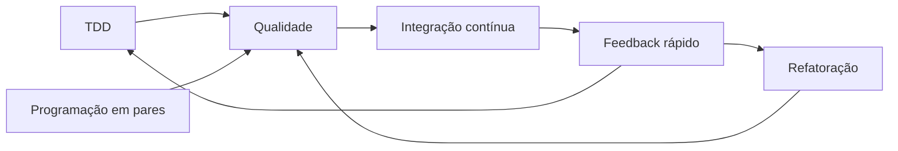

# Aula 12 — XP, Customização, Comunicação e Colaboração

Curso: CST em Sistemas para Internet (4º período)  
Disciplina: Metodologias Ágeis  

---

## Slide 1 — Abertura

- Metodologias Ágeis
- Aula 12: XP, customização, comunicação e colaboração
- Continuidade do conteúdo iniciado na Aula 09
- Entrega do B2-T1
- Professor Ranghetti

---

## Slide 2 — Objetivos da aula

- Aprofundar práticas essenciais de Extreme Programming
- Combinar práticas ágeis preservando sua finalidade
- Identificar anti-padrões de customização
- Construir acordos de trabalho e políticas explícitas
- Planejar comunicação eficaz com equipe e stakeholders
- Aplicar feedback e técnicas introdutórias de gestão de conflitos
- Elaborar um plano de comunicação para um time web

---

## Slide 3 — Agenda da Aula 12

- Retomada da Aula 09
- Entrega e socialização do B2-T1
- XP: TDD, integração contínua, pares e refatoração
- Customização e processos híbridos
- Acordos de trabalho e políticas explícitas
- Comunicação, colaboração e stakeholders
- Feedback e conflitos
- Atividade prática integrada
- Lançamento do B2-T2
- Glossário, referências e fechamento

---

## Slide 4 — Cronograma atualizado

| Data prevista | Situação ou conteúdo |
|---:|---|
| 09 | Não realizada devido às chuvas |
| Jornada | Sem aula regular |
| 10 | Continuidade da Jornada Acadêmica |
| 11 | Conteúdo da Aula 09 aplicado |
| **12 — hoje** | **XP, customização, comunicação e colaboração** |
| 13 | Auto-organização, ferramentas, estimativas e planejamento |
| 14 | Oficina integradora, revisão e entregas finais |

---

## Slide 5 — Retomada da Aula 09

- Metodologias não são receitas universais
- A escolha começa pelo diagnóstico do contexto
- Scrum, Kanban e XP possuem ênfases diferentes
- Adaptar exige preservar a finalidade da prática
- Uma combinação precisa responder a problemas reais
- Evidências permitem revisar a decisão

---

## Slide 6 — B2-T1: entrega e socialização

- Cada equipe apresenta em até 4 minutos:
  - Contexto analisado
  - Problema prioritário
  - Abordagem escolhida
  - Práticas selecionadas
  - Principal risco e mitigação
  - Evidência esperada
- A turma verifica se a escolha é coerente com o diagnóstico

---

## Slide 7 — O que o XP acrescenta?

- Feedback técnico rápido
- Qualidade incorporada ao processo
- Mudanças pequenas e frequentes
- Colaboração intensa
- Design simples e melhoria contínua
- Disciplina para sustentar entregas frequentes

### Ideia central

Agilidade sem qualidade técnica acumula problemas e reduz a capacidade futura.

---

## Slide 8 — Valores do XP

| Valor | Aplicação prática |
|---|---|
| Comunicação | Compartilhar decisões e impedimentos |
| Simplicidade | Implementar o necessário agora |
| Feedback | Validar código, solução e direção rapidamente |
| Coragem | Corrigir problemas e mudar quando necessário |
| Respeito | Reconhecer pessoas e responsabilidades coletivas |

---

## Slide 9 — Práticas que se reforçam

- Uma prática isolada pode produzir benefício limitado
- O conjunto cria ciclos curtos de aprendizagem e correção

---

## Slide 10 — TDD: ciclo essencial

- Escrever um teste para o comportamento desejado
- Confirmar que ele falha pela razão correta
- Implementar apenas o necessário
- Melhorar o código mantendo os testes aprovados

---

## Slide 11 — TDD não é apenas testar depois

- Em TDD, o teste participa do design
- O ciclo orienta passos pequenos
- Benefícios possíveis:
  - Feedback rápido
  - Regressões detectadas
  - Código mais testável
  - Segurança para refatorar
- Limite:
  - Testes ruins também geram falsa confiança

---

## Slide 12 — Integração contínua

- Integrar pequenas alterações frequentemente
- Executar build e testes automaticamente
- Tornar falhas visíveis
- Corrigir rapidamente a branch compartilhada
- Evitar longos períodos de trabalho isolado
- Manter o produto em estado verificável

---

## Slide 13 — Programação em pares

- Duas pessoas colaboram no mesmo problema
- Papéis comuns:
  - Driver: escreve e executa a ação imediata
  - Navigator: revisa, questiona e pensa adiante
- Os papéis devem alternar
- O objetivo é qualidade e aprendizagem, não fiscalização

---

## Slide 14 — Quando usar pares

- Problema complexo ou arriscado
- Conhecimento concentrado em uma pessoa
- Integração de integrante novo
- Decisão de arquitetura
- Correção crítica
- Trecho sensível à segurança

### Não precisa ocorrer o tempo todo

A equipe pode aplicar a prática onde o benefício justifica o esforço.

---

## Slide 15 — Refatoração

- Melhora a estrutura interna
- Preserva o comportamento observável
- Reduz duplicação e complexidade
- Melhora nomes e responsabilidades
- Deve ocorrer em passos pequenos
- Testes ajudam a reduzir risco

---

## Slide 16 — Refatoração não é reescrita total

| Refatoração | Reescrita |
|---|---|
| Pequena e incremental | Substituição ampla |
| Preserva comportamento | Pode redefinir comportamento |
| Apoiada por verificações | Exige nova validação abrangente |
| Risco controlado por passos | Risco concentrado |

---

## Slide 17 — Customizar com responsabilidade

1. Diagnosticar o problema
2. Entender o propósito da prática
3. Definir a adaptação
4. Tornar a política explícita
5. Escolher evidências
6. Experimentar por período limitado
7. Inspecionar e ajustar

---

## Slide 18 — Processo híbrido

- Pode combinar, por exemplo:
  - Objetivos e cadência do Scrum
  - Gestão de fluxo do Kanban
  - Práticas técnicas do XP
- A combinação deve formar um sistema coerente
- Nomes conhecidos não compensam objetivos contraditórios

---

## Slide 19 — Exemplo coerente

- Produto web com releases frequentes
- Scrum para objetivos e revisão do produto
- Kanban dentro da Sprint para visualizar o fluxo
- Limites de WIP para reduzir multitarefa
- TDD e integração contínua para qualidade
- Retrospectiva para revisar processo e acordos

---

## Slide 20 — Exemplo incoerente

- Daily usada para cobrança individual
- Sprint com escopo alterado diariamente sem negociação
- Quadro sem representar o trabalho real
- WIP sem limite
- “TDD” com testes escritos somente no fim
- Retrospectiva sem ações acompanhadas

---

## Slide 21 — Ágil de fachada

- Cerimônias existem, mas não há inspeção ou adaptação
- Equipe recebe tarefas sem autonomia
- Métricas são usadas para punir indivíduos
- Problemas são escondidos para manter aparência de sucesso
- “Híbrido” significa ausência de regras claras
- Velocidade é confundida com valor

---

## Slide 22 — Acordos de trabalho

- Compromissos construídos pelo time
- Exemplos:
  - Horários e disponibilidade
  - Canais de comunicação
  - Prazo para responder
  - Como pedir ajuda
  - Como revisar trabalho
  - Como decidir
  - Como lidar com urgências
- Devem ser visíveis e revisáveis

---

## Slide 23 — Política explícita

| Política | Exemplo |
|---|---|
| Entrada | Item possui objetivo e critério de aceitação |
| Execução | Cada pessoa mantém no máximo um item ativo |
| Revisão | Outro integrante revisa antes de concluir |
| Bloqueio | Impedimento recebe marcador e responsável |
| Conclusão | Definition of Done atendida |

---

## Slide 24 — Comunicação não é volume de reuniões

- Comunicação eficaz entrega a informação necessária
- Deve considerar:
  - Pessoa certa
  - Momento certo
  - Canal adequado
  - Linguagem compreensível
  - Registro proporcional ao risco
- Mais mensagens podem produzir mais ruído, não mais clareza

---

## Slide 25 — Comunicação síncrona e assíncrona

| Síncrona | Assíncrona |
|---|---|
| Resposta imediata | Resposta em outro momento |
| Útil para ambiguidade e conflito | Útil para registro e foco |
| Reunião, chamada, conversa | Issue, documento, mensagem |
| Exige coincidência de agenda | Exige clareza de contexto |

- Um time saudável combina as duas formas

---

## Slide 26 — Stakeholders

- Pessoas ou grupos afetados ou interessados
- Exemplos:
  - Usuários
  - Cliente
  - Patrocinador
  - Suporte
  - Operações
  - Segurança
  - Área jurídica
- Cada stakeholder precisa de informação e frequência adequadas

---

## Slide 27 — Mapa de comunicação

| Público | Informação | Canal | Frequência | Responsável |
|---|---|---|---|---|
| Time | Progresso e bloqueios | Quadro e Daily | Diária | Time |
| Product Owner | Decisões e prioridades | Refinamento | Semanal | PO e time |
| Usuários | Incremento e feedback | Review | Por ciclo | PO |
| Gestão | Riscos e resultados | Síntese | Quinzenal | Responsável definido |

---

## Slide 28 — Feedback eficaz

- Específico, não genérico
- Baseado em comportamento observável
- Próximo do acontecimento
- Orientado a melhoria
- Permite diálogo
- Evita julgamento da pessoa

### Estrutura simples

Situação → comportamento observado → impacto → próximo acordo.

---

## Slide 29 — Exemplo de feedback

### Fraco

“Você nunca colabora.”

### Melhor

“Na revisão de ontem, duas decisões ficaram apenas na conversa e não foram registradas. Isso gerou interpretações diferentes. Podemos registrar decisões no item antes de encerrá-lo?”

---

## Slide 30 — Conflito em times ágeis

- Divergência não é automaticamente negativa
- Pode revelar:
  - Risco ignorado
  - Objetivo ambíguo
  - Dependência oculta
  - Valores ou prioridades diferentes
- O problema cresce quando o conflito é pessoal, escondido ou não tratado

---

## Slide 31 — Tratamento inicial de conflitos

1. Separar fatos de interpretações
2. Ouvir as perspectivas
3. Reafirmar o objetivo comum
4. Identificar necessidades e restrições
5. Construir opções
6. Definir acordo verificável
7. Acompanhar o resultado

---

## Slide 32 — Segurança psicológica

- Possibilidade de falar sobre dúvida, erro e risco
- Não elimina responsabilidade
- Favorece:
  - Aprendizagem
  - Pedido de ajuda
  - Identificação precoce de problemas
  - Feedback honesto
- Culpar pessoas incentiva ocultação; analisar o sistema incentiva melhoria

---

## Slide 33 — Cerimônias com propósito

| Encontro | Resultado esperado |
|---|---|
| Refinamento | Itens compreendidos e preparados |
| Planning | Objetivo e plano inicial |
| Daily | Plano diário adaptado |
| Review | Feedback sobre resultado e direção |
| Retrospectiva | Melhoria do modo de trabalho |

- Sem resultado claro, a reunião vira ritual

---

## Slide 34 — Atividade: cenário

- Equipes de até 5 integrantes
- Produto: plataforma web de atendimento estudantil
- Problemas:
  - Mudanças frequentes
  - Defeitos após integração
  - Stakeholders recebem informações diferentes
  - Reuniões longas e pouco conclusivas
  - Conhecimento concentrado
- Objetivo: desenhar uma forma de trabalho coerente

---

## Slide 35 — Atividade: processo híbrido

- Escolher práticas de Scrum, Kanban e XP
- Para cada prática, registrar:
  - Problema atendido
  - Finalidade
  - Adaptação proposta
  - Evidência de resultado
- Definir fluxo e cadência
- Limitar o processo ao necessário

---

## Slide 36 — Atividade: comunicação

- Criar um mapa contendo:
  - Público
  - Informação necessária
  - Canal
  - Frequência
  - Responsável
- Definir cinco acordos de trabalho
- Escrever duas políticas explícitas do fluxo
- Propor como tratar um conflito de prioridade

---

## Slide 37 — Atividade: apresentação

- Apresentação de até 5 minutos
- Mostrar:
  - Diagnóstico
  - Práticas selecionadas
  - Fluxo e cadência
  - Acordos
  - Mapa de comunicação
  - Risco principal
- Outra equipe fará uma pergunta crítica

---

## Slide 38 — Trabalho B2-T2: lançamento

- Tema:
  - Plano de colaboração, comunicação e organização do time
- Valor:
  - Até 1,0 ponto
- Equipes:
  - Conforme organização definida pelo professor
- Entrega:
  - Aula 13

---

## Slide 39 — B2-T2: entregáveis

- Contexto resumido do time e produto
- Stakeholders principais
- Mapa de comunicação
- Roteiro de pelo menos três cerimônias
- Acordos de trabalho
- Regras para feedback e decisão
- Estratégia inicial para conflitos
- Indicadores de saúde do time
- Justificativas das escolhas

---

## Slide 40 — Indicadores de saúde do time

- Clareza de objetivo
- Percepção de segurança para falar
- Impedimentos recorrentes
- Participação nas decisões
- Ações de retrospectiva concluídas
- Dependência de especialistas
- Qualidade da comunicação com stakeholders

### Cuidado

Indicadores apoiam conversa e melhoria; não devem rotular pessoas.

---

## Slide 41 — B2-T2: critérios de avaliação

| Critério | Valor |
|---|---:|
| Coerência com o contexto e stakeholders |  |
| Qualidade do mapa e dos roteiros de comunicação |  |
| Acordos, feedback e tratamento de conflitos |  |
| Indicadores e justificativas |  |
| Organização e apresentação |  |
| **Total** | **1,00** |

---

## Slide 42 — Checklist do B2-T2

- O contexto está claro?
- Stakeholders foram identificados?
- Cada encontro possui objetivo e saída?
- Canais e frequências são coerentes?
- Os acordos podem ser observados?
- Existe forma de registrar decisões?
- Feedback e conflitos foram considerados?
- Indicadores apoiam melhoria?
- Outro time entenderia o plano?

---

## Slide 43 — Glossário: XP

| Termo | Significado |
|---|---|
| **XP** | Extreme Programming, abordagem focada em feedback e qualidade técnica |
| **TDD** | Desenvolvimento orientado por testes no ciclo Red, Green e Refactor |
| **Integração contínua** | Integração e verificação frequente de pequenas alterações |
| **Pair programming** | Trabalho colaborativo em pares com papéis alternados |
| **Refatoração** | Melhoria interna sem mudar o comportamento observável |

---

## Slide 44 — Glossário: colaboração

| Termo | Significado |
|---|---|
| **Stakeholder** | Pessoa ou grupo interessado ou afetado pelo produto |
| **Acordo de trabalho** | Compromisso explícito sobre como o time colabora |
| **Política explícita** | Regra visível que orienta decisões no fluxo |
| **Feedback** | Informação usada para confirmar ou ajustar ação |
| **Segurança psicológica** | Condição para expor dúvidas, erros e riscos sem humilhação |

---

## Slide 45 — Referências bibliográficas

- DINSMORE, Paul C.; BREWIN, Jeannette C. *AMA — Manual de Gerenciamento de Projetos*. Brasport, 2009.
- VARGAS, Ricardo. *Manual Prático do Plano de Projeto*. 3. ed. Brasport, 2007.
- PRESSMAN, Roger S. *Engenharia de Software*. 6. ed. AMGH, 2010.
- SCHWABER, Ken. *Agile Project Management with Scrum*. Microsoft Press, 2004.

---

## Slide 46 — Referências complementares

- BECK, Kent; ANDRES, Cynthia. *Extreme Programming Explained*. 2. ed. Addison-Wesley, 2004.
- SCHWABER, Ken; SUTHERLAND, Jeff. *The Scrum Guide*. 2020. <https://scrumguides.org/>
- COLEMAN, John et al. *The Kanban Guide*. 2025. <https://kanbanguides.org/the-kanban-guide/>
- AGILE ALLIANCE. *Agile Glossary*. <https://www.agilealliance.org/agile101/agile-glossary/>

---

## Slide 47 — Fechamento

- XP conecta agilidade e qualidade técnica
- Práticas combinadas precisam formar um sistema coerente
- Políticas e acordos reduzem ambiguidades
- Comunicação deve produzir entendimento e decisão
- Feedback e conflito podem gerar aprendizagem
- B2-T1 entregue
- B2-T2 lançado para a Aula 13

---

## Slide 48 — Próxima aula

### Aula 13

- Entrega e feedback do B2-T2
- Auto-organização e liderança distribuída
- Ferramentas para gestão ágil
- Estimativas e planejamento adaptativo
- Lançamento do B2-T3 e B2-T4
