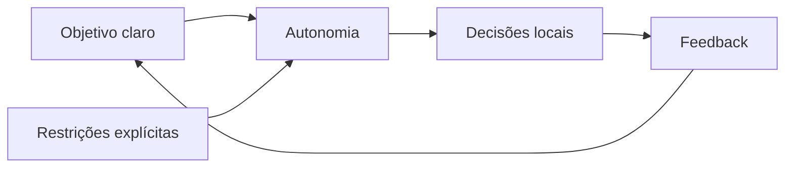
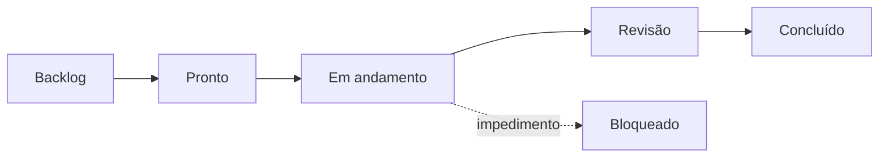

# Aula 13 — Auto-organização, Ferramentas, Estimativas e Planejamento

Curso: CST em Sistemas para Internet (4º período)  
Disciplina: Metodologias Ágeis  

---

## Slide 1 — Abertura

- Metodologias Ágeis
- Aula 13: auto-organização, ferramentas, estimativas e planejamento adaptativo
- Entrega do B2-T2
- Lançamento do B2-T3 e B2-T4
- Professor Ranghetti

---

## Slide 2 — Objetivos da aula

- Diferenciar auto-organização de ausência de direção
- Compreender liderança distribuída e facilitação
- Organizar trabalho ágil em ferramentas digitais
- Definir colunas, itens, labels, políticas e templates
- Aplicar estimativas relativas
- Conduzir uma rodada de Planning Poker
- Construir um planejamento adaptativo com incerteza explícita

---

## Slide 3 — Agenda da Aula 13

- Retomada e entrega do B2-T2
- Auto-organização, autonomia e alinhamento
- Liderança distribuída e facilitação
- Times multidisciplinares
- Ferramentas de gestão ágil
- Organização de board e backlog
- Estimativas relativas e Planning Poker
- Planejamento adaptativo
- Oficina integrada
- Lançamento dos trabalhos finais

---

## Slide 4 — Onde estamos

| Aula | Conteúdo |
|---:|---|
| 11 | Conteúdo da Aula 09 aplicado |
| 12 | XP, customização, comunicação e colaboração |
| **13** | **Auto-organização, ferramentas, estimativas e planejamento** |
| 14 | Oficina integradora, revisão e entregas finais |

- Hoje concentramos temas relacionados para preservar o plano de ensino

---

## Slide 5 — B2-T2: entrega e feedback

- Apresentar em até 4 minutos:
  - Contexto e stakeholders
  - Mapa de comunicação
  - Uma cerimônia detalhada
  - Dois acordos de trabalho
  - Estratégia para conflito
  - Indicador de saúde do time
- Feedback cruzado: clareza, viabilidade e lacunas

---

## Slide 6 — O que é auto-organização?

- Capacidade do time de organizar o trabalho para atingir objetivos
- Envolve:
  - Responsabilidade
  - Autonomia
  - Transparência
  - Coordenação
  - Aprendizagem
- Não elimina restrições, estratégia ou prestação de contas

---

## Slide 7 — Autonomia com alinhamento



- Autonomia sem objetivo produz dispersão
- Alinhamento sem autonomia produz dependência
- Times eficazes precisam dos dois

---

## Slide 8 — Auto-organização não significa

- Cada pessoa fazer o que quiser
- Ausência de prioridades
- Falta de liderança
- Decisões sem transparência
- Ignorar competências e responsabilidades
- Eliminar acompanhamento
- Transferir problemas organizacionais ao time

---

## Slide 9 — Condições necessárias

- Objetivo compartilhado
- Limites de decisão conhecidos
- Informação acessível
- Competências adequadas
- Feedback frequente
- Segurança para levantar riscos
- Tempo para aprender e melhorar
- Confiança acompanhada de responsabilidade

---

## Slide 10 — Liderança distribuída

- Liderança pode emergir conforme a necessidade
- A pessoa que lidera uma decisão pode variar
- Autoridade formal não concentra todo o conhecimento
- Exemplos:
  - Especialista facilita decisão técnica
  - Product Owner orienta valor e prioridade
  - Integrante conduz retrospectiva
  - Pessoa próxima ao problema coordena resposta

---

## Slide 11 — Liderar não é centralizar

| Centralização | Liderança distribuída |
|---|---|
| Decisão sobe na hierarquia | Decisão ocorre no nível adequado |
| Informação é controlada | Informação é compartilhada |
| Dependência de uma pessoa | Capacidade distribuída |
| Execução por ordem | Coordenação por objetivo e limites |

---

## Slide 12 — Facilitação

- Ajuda o grupo a produzir um resultado
- Cuida do processo da conversa
- Mantém objetivo, tempo e participação visíveis
- Separa facilitação de decisão
- Faz perguntas em vez de impor resposta
- Registra acordos e próximos passos

---

## Slide 13 — Decisões no time

| Tipo | Forma possível |
|---|---|
| Reversível e de baixo risco | Pessoa responsável decide |
| Técnica com impacto compartilhado | Consulta a especialistas |
| Estratégica | Responsável definido com participação |
| Urgente | Decisão rápida e revisão posterior |
| Alto risco | Evidências, critérios e aprovação necessária |

- Nem toda decisão exige consenso

---

## Slide 14 — Times multidisciplinares

- Reúnem competências necessárias para gerar valor
- Reduzem transferências e esperas
- Exigem compartilhamento de conhecimento
- Especialidades continuam existindo
- O objetivo é reduzir dependências críticas, não tornar todos idênticos

---

## Slide 15 — Matriz de competências

| Competência | Ana | Bruno | Carla | Diego |
|---|---:|---:|---:|---:|
| Front-end | 3 | 1 | 2 | 1 |
| Back-end | 1 | 3 | 2 | 2 |
| Testes | 2 | 1 | 3 | 2 |
| Cloud | 1 | 2 | 1 | 3 |

- Exemplo de escala: 1 = básico, 2 = executa, 3 = orienta
- A matriz direciona aprendizagem e colaboração

---

## Slide 16 — Ferramenta não é metodologia

- Um board não cria fluxo por si só
- Colunas bonitas não garantem transparência
- Automação não corrige política incoerente
- A ferramenta deve representar o processo real
- Primeiro definir a necessidade; depois configurar o recurso

---

## Slide 17 — Ferramentas previstas

| Ferramenta | Uso típico |
|---|---|
| Jira | Backlog, Scrum, Kanban, relatórios e workflows |
| Trello | Quadros visuais simples e colaboração |
| Azure DevOps Boards | Backlog, boards e integração ao ciclo de desenvolvimento |
| GitHub Projects | Issues, pull requests, campos e visualizações |

- A escolha depende do contexto e das integrações necessárias

---

## Slide 18 — Critérios de escolha

- Tipo e tamanho do trabalho
- Facilidade de uso
- Integração com repositório
- Automação necessária
- Relatórios e métricas
- Controle de acesso
- Custo
- Portabilidade dos dados
- Conhecimento da equipe

---

## Slide 19 — Estrutura mínima de um board



- As colunas devem representar estados reais
- Cada transição precisa de uma política compreensível

---

## Slide 20 — Colunas demais ou de menos

### Poucas colunas

- Escondem espera, revisão e bloqueios

### Colunas demais

- Aumentam manutenção e ambiguidade

### Critério

Representar diferenças importantes para gerir o fluxo.

---

## Slide 21 — Um bom item de trabalho

- Título objetivo
- Resultado ou necessidade
- Contexto suficiente
- Critérios de aceitação
- Prioridade
- Responsável quando necessário
- Dependências e riscos
- Tamanho compatível com o fluxo

---

## Slide 22 — Template de issue

```text
Objetivo:
Como [usuário], quero [necessidade], para [benefício].

Critérios de aceitação:
- Dado...
- Quando...
- Então...

Observações e restrições:
- ...

Definition of Done aplicável:
- ...
```

---

## Slide 23 — Labels e campos

- Tipo: funcionalidade, defeito, melhoria
- Área: front-end, back-end, infraestrutura
- Risco: baixo, médio, alto
- Prioridade: usar com política explícita
- Sprint ou iteração
- Estimativa
- Evitar labels duplicadas ou sem uso decisório

---

## Slide 24 — Automação útil

- Mover item após evento conhecido
- Sinalizar item bloqueado
- Associar pull request à issue
- Fechar item quando critérios forem atendidos
- Notificar responsável por revisão
- Calcular indicadores sem trabalho manual excessivo

### Cuidado

Automatizar um processo confuso apenas acelera a confusão.

---

## Slide 25 — Métricas da ferramenta

- Lead time
- Cycle time
- Throughput
- Trabalho em progresso
- Tempo bloqueado
- Itens envelhecendo
- Previsão baseada no histórico

- Métrica deve apoiar decisão, não competição individual

---

## Slide 26 — Por que estimar?

- Apoiar conversa sobre entendimento
- Comparar tamanho relativo
- Expor risco e incerteza
- Planejar capacidade e opções
- Comunicar cenários

### Estimativa não é promessa exata

É uma avaliação baseada no conhecimento disponível.

---

## Slide 27 — Estimativa absoluta e relativa

| Absoluta | Relativa |
|---|---|
| Horas ou dias | Comparação entre itens |
| Parece direta | Combina esforço, complexidade e incerteza |
| Pode sugerir precisão excessiva | Exige referência compartilhada |
| Útil em alguns contextos | Comum em times ágeis |

---

## Slide 28 — Story points

- Unidade relativa definida pelo time
- Pode considerar:
  - Complexidade
  - Esforço
  - Incerteza
  - Dependências
- Não equivalem automaticamente a horas
- Não devem comparar produtividade entre equipes

---

## Slide 29 — Sequência de Fibonacci modificada

`1, 2, 3, 5, 8, 13, 20...`

- A distância cresce com a incerteza
- Diferenças grandes incentivam dividir itens
- O número importa menos que a conversa
- O time precisa de itens de referência

---

## Slide 30 — T-shirt sizes

- XS, S, M, L, XL
- Útil para visão inicial e comparação rápida
- Pode ser convertido depois, se necessário
- Itens XL sinalizam necessidade de divisão ou descoberta
- Não elimina discussão sobre risco

---

## Slide 31 — Planning Poker

1. Apresentar o item
2. Esclarecer dúvidas
3. Cada pessoa escolhe uma estimativa
4. Revelar simultaneamente
5. Ouvir extremos
6. Discutir premissas
7. Estimar novamente
8. Registrar decisão e incertezas

---

## Slide 32 — Por que revelar ao mesmo tempo?

- Reduz ancoragem na primeira opinião
- Inclui perspectivas diferentes
- Expõe entendimentos divergentes
- Evita que autoridade defina o número antes do debate
- A discordância é dado útil, não falha da reunião

---

## Slide 33 — Exemplo de divergência

- Item: recuperação de senha
- Votos: `3, 3, 5, 13`
- O voto 13 conhece dependência de serviço de e-mail
- O voto 3 pressupõe serviço já disponível
- A discussão revela uma premissa não compartilhada
- Resultado: investigar dependência ou dividir o item

---

## Slide 34 — Planejamento adaptativo

- Planejar em níveis diferentes
- Revisar conforme surgem evidências
- Detalhar mais o futuro próximo
- Manter opções no futuro distante
- Aceitar mudança sem abandonar direção
- Usar objetivos em vez de uma lista rígida

---

## Slide 35 — Cone de incerteza


- A estimativa tende a melhorar conforme o time aprende
- Precisão artificial no início não remove a incerteza

---

## Slide 36 — Capacidade e velocidade

- Capacidade: disponibilidade do time no período
- Velocidade: quantidade de pontos concluídos por iteração
- Velocidade é histórica e específica do time
- Deve apoiar planejamento, não meta individual
- Mudanças de equipe e contexto reduzem comparabilidade

---

## Slide 37 — Planejamento de Sprint

- Definir objetivo da Sprint
- Verificar capacidade
- Selecionar itens relacionados ao objetivo
- Esclarecer critérios de aceitação
- Dividir trabalho quando necessário
- Identificar dependências e riscos
- Construir plano inicial adaptável

---

## Slide 38 — Oficina integrada

- Configurar um board para um produto web
- Criar:
  - Colunas e políticas
  - Labels ou campos
  - Template de item
  - Cinco itens completos
- Estimar os cinco itens
- Selecionar uma Sprint e formular seu objetivo
- Justificar decisões

---

## Slide 39 — Rodada de Planning Poker

- Escolher três itens
- Votar individualmente
- Registrar a primeira distribuição
- Ouvir maior e menor estimativa
- Identificar premissas diferentes
- Votar novamente
- Registrar estimativa e risco

---

## Slide 40 — Trabalho B2-T3: lançamento

- Tema:
  - Configuração de ferramenta e padronização do fluxo
- Valor:
  - Até 1,0 ponto
- Entrega:
  - Aula 14
- Equipes:
  - Conforme organização definida pelo professor

---

## Slide 41 — B2-T3: entregáveis

- Board configurado em ferramenta escolhida
- Colunas e políticas explícitas
- Limite de WIP quando aplicável
- Labels ou campos padronizados
- Template de item
- Cinco itens bem descritos
- Evidências de uso do fluxo
- Breve justificativa da configuração

---

## Slide 42 — B2-T3: critérios

| Critério | Valor |
|---|---:|
| Coerência do board com o fluxo |  |
| Políticas, WIP, labels e convenções |  |
| Qualidade dos itens e template |  |
| Evidências e justificativas |  |
| Organização e demonstração |  |
| **Total** | **1,00** |

---

## Slide 43 — Trabalho B2-T4: lançamento

- Tema:
  - Mini-projeto integrador: processo, backlog e planejamento
- Valor:
  - Até 1,0 ponto
- Entrega:
  - Aula 14
- Pode utilizar o mesmo cenário e board do B2-T3
- O B2-T4 avalia planejamento e integração dos conceitos

---

## Slide 44 — B2-T4: entregáveis

- Contexto e objetivo do produto
- Abordagem ágil adaptada
- Backlog priorizado
- Estimativas justificadas
- Objetivo e planejamento de uma Sprint
- Políticas de fluxo e Definition of Done
- Comunicação e responsabilidades
- Riscos e respostas
- Evidências utilizadas para adaptação

---

## Slide 45 — B2-T4: critérios

| Critério | Valor |
|---|---:|
| Integração coerente dos conceitos |  |
| Backlog, priorização e estimativas |  |
| Planejamento, fluxo e Definition of Done |  |
| Riscos, comunicação e adaptação |  |
| Organização e apresentação |  |
| **Total** | **1,00** |

---

## Slide 46 — Glossário

| Termo | Significado |
|---|---|
| **Auto-organização** | Capacidade de organizar o trabalho dentro de objetivos e limites |
| **Liderança distribuída** | Liderança exercida por diferentes pessoas conforme a necessidade |
| **Facilitação** | Condução do processo de colaboração para produzir resultado |
| **Story point** | Unidade de estimativa relativa definida pelo time |
| **Planning Poker** | Técnica colaborativa de estimativa com revelação simultânea |
| **Planejamento adaptativo** | Planejamento revisado à medida que novas evidências surgem |

---

## Slide 47 — Referências

- DINSMORE, Paul C.; BREWIN, Jeannette C. *AMA — Manual de Gerenciamento de Projetos*. Brasport, 2009.
- VARGAS, Ricardo. *Manual Prático do Plano de Projeto*. 3. ed. Brasport, 2007.
- SCHWABER, Ken; SUTHERLAND, Jeff. *The Scrum Guide*. 2020. <https://scrumguides.org/>
- COLEMAN, John et al. *The Kanban Guide*. 2025. <https://kanbanguides.org/the-kanban-guide/>
- GITHUB. *About Projects*. <https://docs.github.com/issues/planning-and-tracking-with-projects/learning-about-projects/about-projects>

---

## Slide 48 — Fechamento e próxima aula

- B2-T2 entregue
- Auto-organização combina autonomia e alinhamento
- Ferramentas devem representar o processo real
- Estimativas apoiam conversa e decisão
- Planejamento é adaptado com novas evidências
- Para a Aula 14:
  - Finalizar B2-T3 e B2-T4
  - Preparar demonstração
  - Revisar os conteúdos do segundo bimestre
