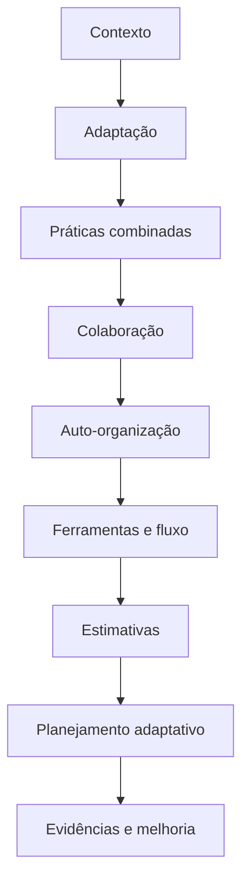

# Aula 14 — Oficina Integradora e Revisão do Segundo Bimestre

Curso: CST em Sistemas para Internet (4º período)  
Disciplina: Metodologias Ágeis  

---

## Slide 1 — Abertura

- Metodologias Ágeis
- Aula 14: oficina integradora e revisão
- Fechamento do segundo bimestre
- Entrega do B2-T3 e B2-T4
- Professor Ranghetti

---

## Slide 2 — Objetivos da aula

- Integrar adaptação, colaboração, ferramentas e planejamento
- Validar um processo ágil para um projeto web
- Demonstrar board, backlog, estimativas e plano de Sprint
- Revisar os conceitos centrais do segundo bimestre
- Identificar erros conceituais frequentes
- Resolver questões e casos de preparação para a avaliação

---

## Slide 3 — Agenda da Aula 14

- Organização da oficina
- Finalização do B2-T3 e B2-T4
- Revisão cruzada entre equipes
- Demonstrações e entregas
- Revisão conceitual guiada
- Simulado
- Correção comentada
- Glossário e referências
- Fechamento do bimestre

---

## Slide 4 — Fechamento do cronograma ajustado

| Data prevista | Realização |
|---:|---|
| 09 | Não realizada devido às chuvas |
| Jornada | Sem aula regular |
| 10 | Continuidade da Jornada Acadêmica |
| 11 | Adaptação de metodologias e introdução ao XP |
| 12 | XP, customização, comunicação e colaboração |
| 13 | Auto-organização, ferramentas, estimativas e planejamento |
| **14** | **Oficina integradora, revisão e entregas finais** |

---

## Slide 5 — Produtos esperados hoje

- B2-T3:
  - Board configurado e fluxo padronizado
- B2-T4:
  - Mini-projeto integrando processo e planejamento
- Demonstração:
  - Decisões, evidências e funcionamento
- Revisão:
  - Conceitos e aplicações do segundo bimestre

---

## Slide 6 — Organização do tempo

| Bloco | Atividade |
|---|---|
| 1 | Finalização e validação dos trabalhos |
| 2 | Revisão cruzada entre equipes |
| 3 | Demonstrações e entrega |
| 4 | Simulado gamificado por equipes |
| 5 | Revisão guiada, correção e fechamento |

- O professor pode ajustar a duração conforme o andamento da turma

---

## Slide 7 — Revisão cruzada

- Cada equipe analisa o trabalho de outra
- Não alterar diretamente o material revisado
- Registrar:
  - Dois pontos fortes
  - Duas dúvidas
  - Uma inconsistência
  - Uma melhoria prioritária
- Basear o feedback nos critérios dos trabalhos

---

## Slide 8 — Revisão cruzada: validação do contexto

- O produto ou serviço web está explicado?
- Usuários e stakeholders estão identificados?
- O principal problema está explícito?
- Restrições foram consideradas?
- A abordagem escolhida responde ao contexto?
- As práticas possuem finalidade clara?

---

## Slide 9 — Revisão cruzada: validação do board

- Colunas representam estados reais?
- Transições possuem políticas?
- Trabalho bloqueado fica visível?
- WIP é controlado quando necessário?
- Itens concluídos atendem à Definition of Done?
- O board ajuda a decidir ou apenas exibe tarefas?

---

## Slide 10 — Revisão cruzada: validação dos itens

- Título objetivo
- Necessidade e benefício
- Critérios de aceitação verificáveis
- Prioridade compreensível
- Estimativa registrada
- Dependências e riscos
- Tamanho adequado ao fluxo
- Labels e campos usados consistentemente

---

## Slide 11 — Revisão cruzada: validação do planejamento

- Backlog ordenado
- Objetivo de Sprint claro
- Capacidade considerada
- Itens relacionados ao objetivo
- Estimativas comparáveis
- Premissas registradas
- Riscos e respostas definidos
- Plano pode ser adaptado com feedback

---

## Slide 12 — Revisão cruzada: comunicação e colaboração

- Stakeholders recebem a informação necessária?
- Canais e frequências estão definidos?
- Cerimônias possuem resultados esperados?
- Decisões ficam registradas?
- Acordos de trabalho são observáveis?
- Existe forma construtiva de tratar conflitos?

---

## Slide 13 — Teste de compreensão

### A equipe revisora deve conseguir responder

- Qual problema o processo resolve?
- Como um item entra e sai do fluxo?
- Quem decide prioridade?
- Como o time identifica bloqueios?
- Como a estimativa foi obtida?
- Que evidência levaria a uma adaptação?

---

## Slide 14 — Demonstração das equipes

- Tempo sugerido: até 6 minutos
- Apresentar:
  1. Contexto e decisão metodológica
  2. Board e políticas
  3. Um item completo
  4. Estimativas e objetivo da Sprint
  5. Comunicação e responsabilidades
  6. Risco e evidência de melhoria

---

## Slide 15 — B2-T3: entrega

- Board acessível ao professor
- Colunas e políticas explícitas
- Limite de WIP quando aplicável
- Labels, campos e template
- Cinco itens bem descritos
- Evidências do fluxo
- Justificativa da configuração

---

## Slide 16 — B2-T3: critérios

| Critério | Valor |
|---|---:|
| Coerência do board com o fluxo |  |
| Políticas, WIP, labels e convenções |  |
| Qualidade dos itens e template |  |
| Evidências e justificativas |  |
| Organização e demonstração |  |
| **Total** | **1,00** |

---

## Slide 17 — B2-T4: entrega

- Contexto e objetivo do produto
- Abordagem adaptada
- Backlog priorizado
- Estimativas justificadas
- Objetivo e planejamento de Sprint
- Políticas e Definition of Done
- Comunicação e responsabilidades
- Riscos, respostas e evidências

---

## Slide 18 — B2-T4: critérios

| Critério | Valor |
|---|---:|
| Integração coerente dos conceitos |  |
| Backlog, priorização e estimativas |  |
| Planejamento, fluxo e Definition of Done |  |
| Riscos, comunicação e adaptação |  |
| Organização e apresentação |  |
| **Total** | **1,00** |

---

## Slide 19 — Dinâmica: simulado interativo

- Iniciar somente após todas as equipes apresentarem e entregarem os trabalhos
- Abrir o site local em `simulado_aula_14_web/index.html`
- Cadastrar duas ou mais equipes e definir a ordem dos turnos
- A equipe da vez escolhe uma questão e discute a resposta
- Conferir imediatamente o resultado e a explicação comentada
- Alternar automaticamente a equipe após cada resposta
- Acompanhar pontuação, acertos, erros e questões restantes
- Ao final, conferir o ranking e revisar os conceitos que exigem reforço

### Recursos da dinâmica

- Trinta questões de múltipla escolha sobre o conteúdo da disciplina
- Cadastro de duas ou mais equipes
- Ordem fixa ou embaralhada
- Feedback imediato
- Gabarito comentado após cada resposta
- Dez pontos por acerto, turnos alternados e ranking final
- Salvamento automático da partida no navegador

---

## Slide 20 — Mapa da revisão

---

## Slide 21 — Adaptação: conceito central

- Ajustar práticas ao contexto
- Preservar propósito e princípios
- Explicitar hipótese e resultado esperado
- Observar evidências
- Revisar a decisão

### Não é

Remover tudo o que exige disciplina ou manter apenas nomes ágeis.

---

## Slide 22 — Diagnóstico do contexto

- Produto e usuários
- Tipo e frequência da demanda
- Equipe e competências
- Tecnologia e dívida técnica
- Organização e governança
- Riscos e restrições
- Frequência necessária de feedback

---

## Slide 23 — Scrum, Kanban e XP

| Abordagem | Ênfase |
|---|---|
| Scrum | Valor, empirismo, objetivos e cadência |
| Kanban | Fluxo, WIP, políticas e melhoria evolutiva |
| XP | Feedback técnico, colaboração e qualidade |

- Podem ser combinados quando objetivos e políticas são coerentes

---

## Slide 24 — Práticas de XP

- TDD: teste orienta pequenos ciclos de desenvolvimento
- Integração contínua: mudanças integradas e verificadas frequentemente
- Programação em pares: colaboração direta sobre o mesmo problema
- Refatoração: melhoria interna preservando comportamento
- As práticas se reforçam mutuamente

---

## Slide 25 — Sinais de ágil de fachada

- Daily como relatório ao chefe
- Sprint sem objetivo
- Quadro desatualizado
- WIP sem limite
- Retrospectiva sem ações
- Métricas para comparar indivíduos
- Mudança constante sem aprendizagem
- Autonomia sem poder real de decisão

---

## Slide 26 — Comunicação eficaz

- Público correto
- Informação necessária
- Canal adequado
- Frequência proporcional
- Responsável conhecido
- Registro compatível com risco
- Feedback que gera ação

---

## Slide 27 — Cerimônias e resultados

| Cerimônia | Resultado |
|---|---|
| Refinamento | Itens compreendidos |
| Planning | Objetivo e plano inicial |
| Daily | Plano adaptado para o dia |
| Review | Feedback sobre produto e direção |
| Retrospectiva | Ação de melhoria do processo |

---

## Slide 28 — Auto-organização

- Autonomia dentro de objetivos e limites
- Responsabilidade coletiva
- Informação transparente
- Decisões no nível adequado
- Competências e colaboração
- Feedback sobre resultado

- Não significa ausência de liderança ou prioridade

---

## Slide 29 — Liderança distribuída

- Liderança varia conforme o problema
- Facilitação apoia o grupo sem monopolizar decisão
- Especialistas orientam sem criar dependência permanente
- Decisões reversíveis podem ser descentralizadas
- Decisões de alto risco exigem critérios e governança

---

## Slide 30 — Ferramenta e processo

- Ferramenta representa o fluxo
- Colunas representam estados reais
- Políticas orientam transições
- Templates melhoram consistência
- Labels e campos apoiam decisão
- Automação reduz trabalho repetitivo
- Métricas tornam comportamento do sistema visível

---

## Slide 31 — WIP e fluxo

- WIP é trabalho iniciado e não concluído
- Limites reduzem multitarefa
- Excesso de WIP aumenta espera
- Sistema puxado inicia trabalho quando há capacidade
- Bloqueios devem ficar visíveis
- Melhorar fluxo não significa manter todos ocupados o tempo todo

---

## Slide 32 — Estimativas ágeis

- Apoiam entendimento e planejamento
- Podem ser relativas
- Story points não equivalem automaticamente a horas
- Planning Poker expõe premissas
- Divergência é oportunidade de conversa
- Estimativa não é garantia

---

## Slide 33 — Planejamento adaptativo

- Orientado por objetivo
- Detalha mais o curto prazo
- Mantém opções no longo prazo
- Considera capacidade e risco
- Usa feedback para revisar decisões
- Evita precisão artificial diante de alta incerteza

---

## Slide 34 — Métricas e decisões

| Métrica | Pergunta útil |
|---|---|
| Lead time | Quanto o cliente espera? |
| Cycle time | Quanto tempo o item permanece em execução? |
| Throughput | Quantos itens terminamos por período? |
| WIP | Quanto trabalho está aberto? |
| Tempo bloqueado | Onde o fluxo perde tempo? |
| Velocidade | Quanto este time concluiu por iteração? |

---

## Slide 35 — Erros frequentes

- Confundir adaptação com ausência de método
- Chamar toda reunião diária de Daily Scrum
- Comparar times por velocidade
- Transformar pontos em horas fixas
- Criar board que não acompanha o processo real
- Considerar item concluído sem critério
- Estimar antes de compreender
- Usar métrica individual como produtividade

---

## Slide 36 — Caso integrado

- Equipe mantém uma plataforma de comércio eletrônico
- Demandas planejadas e incidentes urgentes coexistem
- Defeitos aparecem após integrações
- Marketing muda prioridades frequentemente
- Um desenvolvedor concentra conhecimento de pagamentos
- O board possui apenas “A fazer” e “Feito”

### Pergunta

Quais mudanças você proporia primeiro?

---

## Slide 37 — Resposta possível do caso

- Visualizar etapas reais e bloqueios
- Definir política para urgências
- Limitar WIP
- Adotar integração contínua e testes
- Usar pares para compartilhar conhecimento de pagamentos
- Criar cadência de priorização com Marketing
- Medir tempo e bloqueios antes de redesenhar todo o processo

---

## Slide 38 — Questões abertas para revisão

- Quando combinar Scrum, Kanban e XP?
- Como distinguir adaptação de ágil de fachada?
- Que informações um mapa de comunicação deve conter?
- Como autonomia e alinhamento se relacionam?
- O que torna um board útil para decisão?
- Por que pontos não devem comparar equipes?
- Como evidências sustentam planejamento adaptativo?

---

## Slide 39 — Checklist para avaliação

- Sei diagnosticar um contexto?
- Consigo justificar uma prática?
- Reconheço práticas essenciais de XP?
- Distingo cerimônia de ritual vazio?
- Compreendo auto-organização e liderança distribuída?
- Sei configurar um fluxo mínimo?
- Diferencio lead time, cycle time, throughput e WIP?
- Sei explicar estimativa relativa e Planning Poker?

---

## Slide 40 — Glossário: processo e equipe

| Termo | Significado |
|---|---|
| **Adaptação** | Ajuste ao contexto preservando finalidade |
| **Processo híbrido** | Combinação justificada de práticas |
| **Auto-organização** | Organização autônoma dentro de objetivos e limites |
| **Liderança distribuída** | Liderança exercida conforme competência e necessidade |
| **Política explícita** | Regra visível usada para orientar decisões |

---

## Slide 41 — Glossário: planejamento

| Termo | Significado |
|---|---|
| **Story point** | Unidade relativa definida pelo time |
| **Planning Poker** | Técnica colaborativa de estimativa |
| **Capacidade** | Disponibilidade do time no período |
| **Velocidade** | Pontos concluídos pelo mesmo time em uma iteração |
| **Planejamento adaptativo** | Planejamento revisto com novas evidências |
| **Throughput** | Quantidade de itens concluídos por período |

---

## Slide 42 — Referências bibliográficas

- DINSMORE, Paul C.; BREWIN, Jeannette C. *AMA — Manual de Gerenciamento de Projetos*. Brasport, 2009.
- VARGAS, Ricardo. *Manual Prático do Plano de Projeto*. 3. ed. Brasport, 2007.
- PRESSMAN, Roger S. *Engenharia de Software*. 6. ed. AMGH, 2010.
- SCHWABER, Ken. *Agile Project Management with Scrum*. Microsoft Press, 2004.

---

## Slide 43 — Referências complementares

- BECK, Kent; ANDRES, Cynthia. *Extreme Programming Explained*. 2. ed. Addison-Wesley, 2004.
- SCHWABER, Ken; SUTHERLAND, Jeff. *The Scrum Guide*. 2020. <https://scrumguides.org/>
- COLEMAN, John et al. *The Kanban Guide*. 2025. <https://kanbanguides.org/the-kanban-guide/>
- AGILE ALLIANCE. *Agile 101*. <https://www.agilealliance.org/agile101/>

---

## Slide 44 — Encerramento do bimestre

- B2-T3 e B2-T4 entregues
- Conteúdos do plano integrados ao cronograma reduzido
- Revisão concluída
- Próximo passo:
  - Preparação para a avaliação bimestral
  - Revisão das aulas 09, 12, 13 e 14
  - Estudo dos casos, conceitos, práticas e justificativas

### Pergunta final

Que evidência mostraria que o modo de trabalho realmente melhorou?

